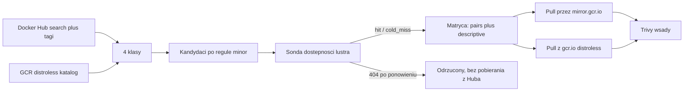

# Plan pracy inżynierskiej — analizator obrazów kontenerowych

Dokument odtworzony z rozmów z 21–23.08.2026 po zmianie nazwy katalogu projektu
(`C:\Projects\PRACA_IN\Code` → `C:\Projects\Container_Image_Anylyzer`), która odcięła historię
czatu. Źródłem są pliki planów `~/.cursor/plans/fetcher_matrycy_92879bdc.plan.md`
(wersja obowiązująca) oraz `~/.cursor/plans/inteligentny_fetcher_2bcd6835.plan.md`
(wcześniejsza, zastąpiona).

Rozdział [Rejestry i ścieżki pobierania](#rejestry-i-ścieżki-pobierania) oraz
[Warianty distroless](#warianty-distroless--dowody-pomiarowe) zawierają **korekty ustaleń
z 13.09.2026**, zweryfikowane empirycznie. Poprawiają one dwa błędy poprzednich planów.
Sekcja [Krok 6 — decyzje i przebieg](#krok-6--decyzje-przebieg-kampanii-i-wnioski-do-pracy)
zamyka orkiestrację (kampania 10–11.10.2026) i zbiera wnioski pod pisanie rozdz. 3 i 5–7.

## Dane oficjalne (APD)

- **Autor:** Kamil Wierzbicki, Wydział Informatyki i Telekomunikacji, Politechnika Wrocławska
- **Promotor:** mgr inż. Jakub Tomaszewski
- **Tytuł (PL):** Analiza porównawcza metod utwardzania środowisk kontenerowych pod kątem
  bezpieczeństwa i optymalizacji powierzchni ataku
- **Tytuł (EN):** Comparative analysis of container environment hardening methods for security
  and attack surface optimization
- **Cel:** kompleksowa analiza porównawcza skuteczności technik minimalizacji podatności
  (redukcja CVE i powierzchni ataku) oraz sformułowanie inżynierskich rekomendacji doboru
  baz systemowych.

Skaner jest **narzędziem badawczym**, nie produktem. Ciężar pracy leży w punktach 5–7.

### Zakres zatwierdzony

1. Wprowadzenie do aspektów bezpieczeństwa łańcucha dostaw i izolacji.
2. Przegląd narzędzi do skanowania i zdefiniowanie kryteriów doboru próby badawczej.
3. Zbudowanie systemu orkiestracji (pobieranie, skanowanie, parsowanie do analizy).
4. Zaprojektowanie i uruchomienie „matrycy testowej" (warianty o różnym stopniu utwardzenia).
5. Wielowymiarowa analiza statystyczna podatności (CVE, rozmiar, komponenty).
6. Porównanie wyników metod utwardzania (Slim, Alpine, Distroless vs Standard).
7. Wyciągnięcie wniosków (balans bezpieczeństwo vs funkcjonalność runtime).

### Jak zakres APD ma się do kroków implementacji

Częste zamieszanie: „Kroki 0–6" z rozdziału [Mikro-kroki](#mikro-kroki) **nie są** alternatywnym
planem pracy. To rozpisanie na zadania programistyczne **wyłącznie punktów 3 i 4** zatwierdzonego
zakresu. Pozostałe punkty albo poprzedzają kod, albo następują po nim.

| Punkt APD | Czym jest | Kroki kodu |
| --- | --- | --- |
| 1. Wprowadzenie, łańcuch dostaw, izolacja | tekst, literatura | brak — pisanie |
| 2. Przegląd narzędzi, kryteria doboru próby | tekst oparty na pomiarach | dane z Kroku 0 i 1 |
| 3. System orkiestracji | **kod** | Kroki 1, 2, 3, 6 |
| 4. Projekt i uruchomienie matrycy | **kod** | Kroki 4, 5 |
| 5. Analiza statystyczna | praca na wynikach | brak — na `scans.jsonl` |
| 6. Porównanie metod utwardzania | praca na wynikach | brak — na parach z `scans.jsonl` |
| 7. Wnioski, balans bezpieczeństwo/funkcjonalność | praca na wynikach | brak — na deltach z pkt 6 |

Wniosek, który warto mieć z tyłu głowy przy planowaniu czasu: **kroki kodu kończą się tam, gdzie
zaczyna się właściwy ciężar pracy**. Krok 6 jest zamknięty (`results/scans.jsonl`); punkty 5–7
dopiero z tej tabeli powstają (`src/Analyze.py` → `figures/` + `analysis_summary.json`).
Rozbudowywanie skanera ponad to, czego wymaga matryca, nie przybliża do obrony. Kanoniczny
przepis analizy i wykresów pod rozdz. 5–7:
[Plan analizy statystycznej](#plan-analizy-statystycznej-punkty-57).

### Literatura

1. Rice L., *Container Security*, O'Reilly 2020
2. Vehent J., *Securing DevOps*, Manning 2018
3. NIST SP 800-190, *Application Container Security Guide*
4. Google Cloud, *Distroless Container Images*
5. FIRST, *CVSS v3.1 Specification Guide*
6. *SLSA Framework* documentation

### Stos technologiczny

- **Architektura:** narzędzia (Trivy, Python, zależności) zamknięte w kontenerze, żeby nie
  instalować ich na maszynie hosta. Pierwotnie w modelu Docker-out-of-Docker z mapowaniem
  `/var/run/docker.sock`; przy `--image-src remote` montowanie gniazda przestaje być potrzebne —
  patrz [Kontener orkiestrujący](#kontener-orkiestrujący-po-co-był-dood-i-co-z-niego-zostaje)
- **Język:** Python — `requests`, `pandas`, `tqdm`, `subprocess`
- **Skaner:** Aqua Security Trivy (wyniki JSON)
- **Źródła:** API Docker Hub oraz Google Container Registry

## Rejestry i ścieżki pobierania

To rozdział najczęściej mylony. Trzy różne hosty, trzy różne role.

### Trzy hosty, trzy role

| Host | Czym jest | Rola w badaniu |
| --- | --- | --- |
| `registry-1.docker.io` (Docker Hub) | kanoniczne źródło obrazów oficjalnych `library/*` i społecznościowych | **źródło** klas `standard`, `slim`, `alpine` |
| `mirror.gcr.io` | pull-through cache **Docker Huba**, hostowany na Artifact Registry | **wyłącznie ścieżka pobierania** dla obrazów z Huba |
| `gcr.io/distroless` | kanoniczny dom obrazów distroless Google | **źródło** klasy `distroless` |

**`mirror.gcr.io` to lustro Docker Huba, nie lustro distroless.** To jego jedyne przeznaczenie.
Nie zawiera obrazów distroless. `gcr.io/distroless` nie jest lustrem czegokolwiek — to
oryginalne, kanoniczne miejsce publikacji obrazów distroless.

Weryfikacja (13.09.2026):

```
mirror.gcr.io/v2/distroless/python3-debian12/manifests/latest  -> 404
gcr.io/v2/distroless/python3-debian12/manifests/latest         -> 200
```

`404` na lustrze jest dowodem rozdzielności: lustro widzi tylko Docker Huba.

### „Czy GCR nie zostało wyłączone?" — odpowiedź na obronę

Pytanie prawdopodobne na obronie, więc warto mieć gotową odpowiedź z cytatami. Mylone są
**usługa** i **domena**:

- **Wyłączona została usługa Container Registry** — z dniem 18.03.2025 nie da się już
  *zapisywać* obrazów do Container Registry, a stara infrastruktura składowania (kubełki Cloud
  Storage) jest wygaszona.
- **Domena `gcr.io` działa dalej**, obsługiwana teraz przez Artifact Registry. Dokumentacja
  Google stwierdza wprost: *„`gcr.io` URLs hosted on Artifact Registry, including Google-owned
  images with `gcr.io` URLs, are **not affected** by the Container Registry shutdown."*

Projekt distroless **celowo pozostaje na `gcr.io`**. Jego README zawiera osobny wpis FAQ
dokładnie na to pytanie:

> *Why is distroless still using `gcr.io` instead of `pkg.dev`? Distroless's serving
> infrastructure has moved to artifact registry but we still use the `gcr.io` domain. Users will
> get the benefits of the newer infrastructure without changing their builds.*

W wątku migracyjnym `GoogleContainerTools/distroless#1630` utrzymujący dodają: *„`gcr.io/distroless`
is now served by the AR infrastructure. The GCR infra is shutting down but the domain `gcr.io`
will continue to be served by AR"*, oraz że referencje obrazów pozostają bez zmian
i **uwierzytelnianie nie jest wymagane** do pobierania.

**Nie „modernizować" adresów na `pkg.dev`.** `pkg.dev/distroless/...` nie działa (wymaga
uwierzytelnienia i innej struktury ścieżek) — jedyną poprawną formą jest `gcr.io/distroless/...`.

Weryfikacja dostępności (13.09.2026) — wszystkie 12 repozytoriów bieżącej linii `debian13`
odpowiadają `200` bez uwierzytelniania:

```
static-debian13     200     java17-debian13     200     nodejs22-debian13   200
base-debian13       200     java21-debian13     200     nodejs24-debian13   200
base-nossl-debian13 200     java25-debian13     200     nodejs26-debian13   200
cc-debian13         200     java-base-debian13  200     python3-debian13    200
```

Linia `debian12` również pozostaje dostępna (`static`, `base`, `python3`, `nodejs22`, `java21`,
`cc` — wszystkie `200`), co daje starsze obserwacje bez dodatkowego ryzyka. Projekt jest aktywnie
utrzymywany (bieżące PR-y podbijające wersje pakietów, wrzesień 2026); harmonogramy wsparcia
poszczególnych linii są w `SUPPORT_POLICY.md` w repozytorium upstream — to źródło kryterium
„która wersja jest wspierana" do rozdz. 2.

**Zabezpieczenie metodologiczne niezależne od losu rejestru.** Praca jest pomiarem
punktu w czasie. Każdy obraz w matrycy jest pinowany digestem i datą pobrania (zgodnie z SLSA),
więc wynik pozostaje cytowalny i weryfikowalny nawet gdyby adresy kiedyś się zmieniły. Ryzyko
rejestru nie jest ryzykiem trafności wyników.

### Discovery vs pull — rozdzielenie, które trzeba utrzymać

Obrazy w badaniu pochodzą **zawsze z dwóch źródeł równolegle**: Docker Hub daje
`standard` / `slim` / `alpine`, GCR daje `distroless`. Lustro nie zmienia składu próby — jest
wyłącznie szczegółem transportowym mówiącym, skąd Trivy ściąga warstwy.

- `logical_ref` — obraz, który opisujesz w pracy (`python:3.11-slim`)
- `pull_ref` — skąd faktycznie lecą warstwy (`mirror.gcr.io/library/python:3.11-slim`)
- `registry` — `hub` / `gcr` / `mirror`

Zmiana `pull_ref` nigdy nie zmienia `logical_ref`. Ten sam obraz logiczny nie może wejść do
matrycy dwa razy (Hub + lustro = 1 wiersz).

### Trzy różne limity — nie mylić w pracy

| Limit | Czego dotyczy | Obejście |
| --- | --- | --- |
| API listowania | search, endpoint tagów; Hub zwraca `429` | cache + backoff + token PAT |
| **Offset paginacji** | **głębokość stronicowania dla żądań anonimowych; Hub zwraca `403`** | **token PAT; dla `library/` trik z `ordering`** |
| Pull warstw | `docker pull` / Trivy; konto darmowe ok. **200 pulli / 6 h** | lustro `mirror.gcr.io` |

#### Limit offsetu — odkryty 18.09.2026, zmienia wykonalność Kroku 3

Hub odmawia anonimowego stronicowania poniżej pewnej głębokości, zwracając `403` z treścią:

```
{"message":"pagination offset too large for anonymous requests; sign in to page further"}
```

Limit dotyczy **offsetu**, nie numeru strony (`page=2&page_size=50` przechodzi, `page=2&page_size=100`
już nie), i jest **różny dla różnych endpointów**. Zmierzone progi:

| Endpoint | Ostatni działający offset | Pierwszy zablokowany |
| --- | --- | --- |
| `/v2/repositories/library/` | 90 | 100 |
| `/v2/search/repositories/` | 100 | 200 |
| `/v2/repositories/{ns}/{name}/tags/` | 900 | 1000 (29.09.2026; wcześniej sprawdzono tylko 3900) |

Sprawdzone: zjawisko **nie zależy** od `User-Agent` ani od biblioteki klienckiej (identyczne
wyniki dla `requests` i `urllib`, dla nagłówka własnego i przeglądarkowego), więc nie jest to
wykrywanie bota, tylko celowa polityka API.

**Obejście dla `library/` bez tokenu.** Repozytoriów jest 181, a anonimowo widać najwyżej
pierwszą setkę. Dwa żądania z przeciwnych końców sortowania pokrywają jednak cały zbiór —
`ordering=pull_count` (malejąco) plus `ordering=-pull_count` (rosnąco) dają część wspólną
19 pozycji i sumę **dokładnie 181**, zgodną z deklarowanym `count`. Odwrócona semantyka
`ordering` przestaje więc być ciekawostką, a staje się narzędziem.

**Konsekwencja dla Kroku 3: token PAT jest wymagany, nie opcjonalny.** Tagów `python` jest
3923, czyli powyżej progu 3900 — ostatnia strona odpadnie. Dla `openjdk` (17 042 tagi)
anonimowo zobaczymy kilka procent zbioru, co uniemożliwiłoby deduplikację i dobór próby.

Przy 10 tys. skanów sam Hub to ~12,5 doby. Dokumentacja Google potwierdza, że pobrania przez
`mirror.gcr.io` **nie są liczone do limitu Docker Huba**. Lustro jest więc **częścią metodyki**,
nie optymalizacją „na później".

Wyłączenie Container Registry (18.03.2025) **nie dotyczy** ani `mirror.gcr.io`, ani obrazów
Google z adresami `gcr.io` — jedno i drugie działa dalej na Artifact Registry.

### Pokrycie lustra — szersze niż zakładał poprzedni plan, ale z dziurami

Poprzedni plan twierdził, że lustro obejmuje tylko `library/*` i ostrzegał „nie udawaj, że
`mirror.gcr.io` ma cały Hub". Pomiar (13.09.2026) pokazuje, że **przestrzenie nieoficjalne też
działają**:

```
mirror.gcr.io/bitnami/nginx      -> 200      mirror.gcr.io/library/nginx     -> 200
mirror.gcr.io/grafana/grafana    -> 200      mirror.gcr.io/library/postgres  -> 200
mirror.gcr.io/prom/prometheus    -> 200      mirror.gcr.io/library/redis     -> 200
mirror.gcr.io/jenkins/jenkins    -> 200      mirror.gcr.io/library/memcached -> 200
                                             mirror.gcr.io/library/traefik   -> 200
                                             mirror.gcr.io/library/caddy     -> 200
```

Stare, niszowe tagi również są dostępne, co przeczy obawie, że cache trzyma tylko obrazy
„frequently requested":

```
mirror.gcr.io/library/python:3.13-slim          -> 200
mirror.gcr.io/library/python:3.10.21-alpine3.24 -> 200
```

**Ale są dziury, i jedna trafia prosto w plan.** `openjdk` — wskazany w poprzednim planie jako
jedno z dwóch dominujących repozytoriów (17 042 tagi) — nie ma na lustrze żadnego z typowych
tagów (pomiar 29.09.2026 wykazał, że obecne są pojedyncze tagi EA, więc nie jest to dziura
całego repozytorium, tylko jego głównych manifestów):

```
mirror.gcr.io/library/openjdk:latest   -> 404
mirror.gcr.io/library/openjdk:17       -> 404
mirror.gcr.io/library/openjdk:21       -> 404
mirror.gcr.io/library/openjdk:17-slim  -> 404
mirror.gcr.io/library/openjdk:24-jdk   -> 404
```

**Konsekwencja projektowa:** fetcher nie może stosować bezwarunkowej reguły przepisywania
`library/{name}` → `mirror.gcr.io/library/{name}`. Musi **sondować dostępność** (`HEAD` na
manifest) i zapisywać wynik w matrycy, z jawnym fallbackiem na Hub. Obrazy spadające na Hub
obciążają licznik 200/6 h, więc muszą być budżetowane osobno.

**Dostępność jest cechą manifestu, nie repozytorium** (pomiar 29.09.2026). Repozytorium
`python` jest na lustrze, a mimo to bardzo stary tag z niego wypadł:

```
mirror.gcr.io/library/python:3.13.0a1-slim  -> 200   (2023)
mirror.gcr.io/library/python:2.7.9-wheezy   -> 404   (2015)
```

Do tego lustro to pull-through cache: **pierwsze 404 bywa chybieniem na zimno** — lustro
pobiera wtedy manifest z Huba i kolejne zapytanie zwraca 200 (zaobserwowane m.in. dla świeżych
tagów `jenkins`, `semeru`, `unit`, `spark`). Część braków jest natomiast trwała
(`openjdk:17`, `python:2.7.9-wheezy`, `java:8`, stare tagi `mysql`, `redis`, `wordpress`).
Sonda per repozytorium (jeden reprezentatywny tag) myliła się więc w obie strony i została
odrzucona.

Stąd sonda **per wiersz matrycy**: `HEAD mirror.gcr.io/v2/<repo>/manifests/<digest amd64>`,
chybienia ponawiane po odczekaniu (`--retry-delay`), wynik zapisywany jako `mirror_probe` =
`hit` / `cold_miss` / `miss`; tylko `miss` kieruje obraz na Hub. Uruchamiana jest dopiero na
wybranej matrycy (po Kroku 5), żeby nie odpytywać setek tysięcy tagów, które i tak odpadną,
i bez cache HTTP, który utrwaliłby pierwsze 404.

Dodatkowo dokumentacja Google zaznacza, że obraz usunięty z Huba może pozostać w cache
**do kilku dni**. To kwestia trafności: teoretycznie można przeskanować obraz, którego już nie
ma w źródle. Do zapisania jako ograniczenie metodologiczne.

**Zabezpieczenie: porównanie digestów.** Lustro zwraca nagłówek `Docker-Content-Digest`, który
dla sprawdzonych tagów jest identyczny z `digest` z API Huba (np. `python:3.13-slim` →
`sha256:7c61056e…` w obu). Sonda per tag porównuje oba digesty, a `pull_ref` jest pinowany
digestem, nie tagiem — dzięki temu skanowany jest dokładnie artefakt opisany w matrycy,
niezależnie od stanu cache lustra.

## Ustalenia zweryfikowane empirycznie

Fakty do zacytowania w rozdz. 2 (kryteria doboru próby):

- Populacja `library/` liczy **181 repozytoriów** — tyle deklaruje `count` i tyle daje suma
  dwóch przebiegów po `ordering` (zweryfikowane 18.09.2026). Pierwotny `page_size=100`
  w `scanner.py` obcinał ją arbitralnie. Uwaga: zwykła paginacja **nie wystarczy**, bo
  anonimowy offset jest ograniczony — patrz [Limit offsetu](#limit-offsetu--odkryty-18092026-zmienia-wykonalność-kroku-3).
- `page_size` jest **po cichu ścinany do 100**. Przy `page_size=1000` Hub zwraca 100 rekordów,
  ale odsyła `page_size=1000` w polu `next`, więc nic nie sygnalizuje obcięcia. Nie wolno liczyć
  oczekiwanej liczby stron jako `count / page_size` z inną wartością.
- API Docker Hub ma **odwróconą semantykę sortowania**: `ordering=pull_count` zwraca malejąco,
  `ordering=-pull_count` rosnąco. Przy sortowaniu wyników polegamy na kliencie, ale sama
  dwukierunkowość jest wykorzystana celowo jako obejście limitu offsetu (patrz wyżej).
- **Dwa endpointy Kroku 1 mają prawie rozłączne pola.** Wspólne są tylko `pull_count`
  i `star_count`:

  | | `/repositories/library/` | `/search/repositories/` |
  | --- | --- | --- |
  | nazwa | `name` + `namespace` | `repo_name` (sklejone) |
  | opis | `description` | `short_description` |
  | data | `last_updated`, `date_registered` | **brak** |
  | oficjalność | brak (wszystko jest oficjalne) | `is_official` |
  | rozmiar | `storage_size` | brak |

  Konsekwencje: potrzebne są **dwie funkcje normalizujące** do wspólnego rekordu; `repo_name`
  wymaga rozbicia, bo oficjalne przychodzą jako `nginx`, a pozostałe jako `bitnami/nginx`
  (bez tego klucz deduplikacji się rozjeżdża i to samo repo wchodzi dwa razy); `last_updated`
  dla wyników z wyszukiwania zostaje puste i jest uzupełniane w Kroku 3.
- **Kolejność źródeł w Kroku 1 jest nośna.** Ponieważ rekord z `library/` jest bogatszy,
  przetwarzamy go **przed** wyszukiwaniem i pomijamy klucze już widziane. Dzięki temu nie
  trzeba pisać logiki scalania rekordów. Weryfikacja przebiegu z 18.09.2026: 1764 unikalne
  repozytoria, zero duplikatów, `last_updated` obecne w dokładnie 181 rekordach.
- **Liczba 1764 była artefaktem limitu anonimowego, nie kryterium doboru.** Przebieg z tokenem
  (29.09.2026, 47 stron na zapytanie) daje **12 971** repozytoriów: 181 oficjalnych + 12 790
  z wyszukiwania `python` / `java` / `nodejs`. Wyszukiwarka zwraca głównie szum — rozkład
  `pull_count` dla wyników z wyszukiwania:

  | Próg `pull_count` | Repozytoriów |
  | --- | --- |
  | ≥ 0 | 12 790 |
  | ≥ 1 000 | 2 535 |
  | ≥ 10 000 | 645 |
  | ≥ 100 000 | 172 |
  | ≥ 1 000 000 | 58 |

  Próg popularności musi więc być jawnym, zapisanym kryterium doboru próby (rozdz. 2),
  a nie skutkiem ubocznym limitu paginacji. Katalog z Kroku 1 zostaje pełny (to spis populacji),
  próg stosuje Krok 3 (`GetTags.py --min-pulls`).
- Populacja tagów to ~700 tys. (`openjdk` 17042, `node` 9036, `python` 3911). Deduplikacja
  redukuje ją o ~2/3 (100 tagów `python` = 33 unikalne obrazy).
- Endpoint tagów zwraca `full_size`, `digest`, `tag_last_pushed` oraz tablicę `images[]`
  z rozmiarem i digestem per architektura. **Wymiar „rozmiar" z pkt 5 dostajemy bez pobierania
  obrazów.**
- `gcr.io/distroless` zawiera tylko ~7 rodzin: `static`, `base`, `cc`, `java` (11/17/21/25),
  `nodejs` (14–26), `python3`, `dotnet` (przestarzały). Distroless dla `nginx`, `postgres`,
  `redis`, `mysql`, `php`, `ruby` **nie istnieje** — to ograniczenie metodologiczne do opisania
  w pracy, nie brak w kodzie.
- Każde repo distroless ma **4 stabilne aliasy**: `latest`, `debug`, `nonroot`, `debug-nonroot`
  (pozostałe ~13 tys. tagów to identyfikatory commitów). Do badania bierzemy **wyłącznie
  `latest`** — patrz Konsekwencje 1 i 2.
- Rozmiary referencyjne `python`: `3.10.21-alpine` ~20 MB, `3.10.21-slim` ~45 MB,
  `latest` ~415 MB.

## Warianty distroless — dowody pomiarowe

Poprzedni plan opisywał cztery aliasy jako **układ czynnikowy 2×2** (powłoka × użytkownik).
Pomiar manifestów `gcr.io/distroless/python3-debian12` (13.09.2026) pokazuje, że to
uproszczenie:

| Tag | Liczba warstw | Różnica względem `latest` |
| --- | --- | --- |
| `latest` | 43 | — (config `2352e7d5…`) |
| `nonroot` | 43 | **warstwy identyczne co do bajta**; różni się tylko config (`8dc1c27e…`) |
| `debug` | 44 | dokładnie **jedna dodatkowa warstwa, 740 164 B** (busybox); config `eca33119…` |
| `debug-nonroot` | 44 | warstwy identyczne z `debug`; różni się tylko config (`61f2d137…`) |

Cztery tagi to zatem **tylko dwa różne inwentarze pakietów**: `{latest, nonroot}` oraz
`{debug, debug-nonroot}`.

Odczyt configu potwierdza, że jedyną różnicą `latest` vs `nonroot` jest użytkownik:

```
python3-debian12:latest   ->  User = "0"
python3-debian12:nonroot  ->  User = "65532"
```

### Pułapka: distroless ma wyzerowane znaczniki czasu

Config obrazów distroless raportuje `created = 1970-01-01T00:00:00Z`. To celowy efekt budowania
reprodukowalnego (Bazel zeruje znaczniki czasu dla determinizmu), nie błąd rejestru.

**Konsekwencja:** pola `created` z configu **nie wolno** używać jako zmiennej „wiek obrazu" ani
jako kryterium świeżości — dla całej klasy `distroless` byłoby stałą równą epoce, co
systematycznie zaburzyłoby każdą analizę korelującą wiek z liczbą CVE. Wiek obrazów z Huba
bierzemy z `tag_last_pushed` z API, a dla distroless trzeba albo zrezygnować z tego wymiaru,
albo wziąć datę z metadanych rejestru (`timeUploaded`), nie z configu. Do zapisania jako
ograniczenie w rozdz. 5.

### Konsekwencja 1 — skanujemy tylko `latest` (decyzja podjęta)

Identyczne warstwy to identyczny inwentarz pakietów, czyli **identyczny zbiór CVE**. Skanowanie
obu wariantów byłoby więc pobraniem tej samej informacji dwa razy.

**Decyzja:** z każdego repozytorium distroless bierzemy **wyłącznie tag `latest`** — jeden wiersz
matrycy na repozytorium. `nonroot` nie jest skanowany.

**Dlaczego `latest`, a nie `nonroot`.** Wybór nie jest dowolny, mimo że dla CVE oba są
równoważne. Obrazy z Huba w klasach `standard`, `slim` i `alpine` domyślnie działają jako root.
Gdybyśmy jako reprezentanta distroless wzięli `nonroot` (`User = "65532"`), do delty
`distroless − standard` wszedłby **dodatkowy czynnik: zmiana użytkownika**, którego pozostałe
klasy nie mają. `latest` ma `User = "0"`, czyli identycznie jak warianty z Huba, więc uprzywilejowanie
pozostaje **stałą w całym porównaniu** i delta mierzy wyłącznie różnice w userlandzie i zestawie
pakietów. To eliminuje confounder, którego inaczej trzeba by tłumaczyć w rozdz. 6.

**`nonroot` nadal jest treścią pracy — tylko nie obserwacją.** Jego właściwości są udowodnione
inspekcją manifestów, bez żadnego skanu: identyczne warstwy, `User = "0"` vs `User = "65532"`.
Wynika z tego wniosek wart osobnego akapitu w punkcie 7: **utwardzenie użytkownika jest w
distroless darmowe** — realizuje zalecenie NIST SP 800-190 o nieuruchamianiu jako root przy
zerowej zmianie liczby CVE i zerowej utracie funkcjonalności. To jedyny punkt w całym badaniu,
gdzie utwardzanie nic nie kosztuje, co dobrze kontrastuje z pozostałymi klasami, gdzie redukcja
CVE zawsze wiąże się z utratą możliwości runtime.

W matrycy odnotowujemy to kolumną `nonroot_available` (własność repozytorium), a nie osobnym
wierszem.

### Konsekwencja 2 — `debug` wyłączony ze zbioru (decyzja podjęta)

**Decyzja:** warianty `debug` i `debug-nonroot` **nie wchodzą do badania**. Nie są rekomendowane
produkcyjnie, więc nie reprezentują realnej metody utwardzania.

Łącznie z Konsekwencją 1 daje to jedną regułę dla całego GCR: **z czterech aliasów zostaje
wyłącznie `latest`**. Fetcher odfiltrowuje `debug`, `debug-nonroot` i `nonroot` już na etapie
enumeracji GCR (Krok 2), a nie dopiero w analizie.

Wiersze `debug` w tabeli powyżej zostają w dokumencie **wyłącznie jako dowód pomiarowy** — to
one pokazują, że aliasy distroless redukują się do dwóch inwentarzy pakietów, co uzasadnia
Konsekwencje 1 i 3. Nie są elementem próby.

Skutkiem jest brak kontrastu wewnątrz identycznej bazy, więc punkt 7 opiera się na innym
schemacie — patrz [Punkt 7: standard jako baseline](#punkt-7-standard-jako-baseline).

### Konsekwencja 3 — błąd w regule deduplikacji

Poprzedni plan deduplikował **po digescie manifestu**. Para `latest` / `nonroot` pokazuje, że to
niewystarczające: mają **różne digesty manifestu i identyczne warstwy**, więc deduplikacja po
digescie ich nie sklei i N spuchnie o duplikaty profili CVE — dokładnie ta pseudoreplikacja,
której plan miał zapobiegać.

W samym GCR problem znika przez decyzję z Konsekwencji 1 (bierzemy tylko `latest`), ale reguła
zostaje potrzebna **po stronie Huba**, gdzie skala jest znacznie większa: aliasy w rodzaju
`3.10-alpine`, `3.10.21-alpine` i `3.10.21-alpine3.24` wskazują ten sam obraz, a część tagów
różni się wyłącznie metadanymi.

**Poprawka:** kluczem deduplikacji dla analizy CVE musi być **lista warstw** (albo `diff_ids`
z rootfs), nie digest manifestu. Digest manifestu zostaje jako identyfikator artefaktu do
cytowania w pracy (pinowanie zgodne z SLSA), ale nie jako klucz niezależności obserwacji.

**Digest indeksu to nie digest obrazu amd64** (pomiar 29.09.2026). `python:3.13`
i `python:3.13-trixie` mają **różne digesty indeksu**, bo pierwszy indeks zawiera dodatkowo
obrazy Windows, ale wskazują **ten sam manifest amd64**. `python:3.13-slim` i
`python:3.13-slim-trixie` są z kolei zwykłymi aliasami z identycznym digestem. Dlatego fetcher
zapisuje obok `digest` (indeks) także `arch_digest` (manifest amd64) i to on jest pierwszym,
tanim stopniem deduplikacji — na próbie `library/` + wyszukiwanie 271 884 wierszy daje tylko
146 894 unikalnych obrazów amd64. `layer_key` pozostaje drugim stopniem, dla obrazów o różnych
manifestach i identycznych warstwach. `pull_ref` jest pinowany właśnie `arch_digest`, więc
skanowany jest dokładnie ten obraz, który został zdeduplikowany.

## Taksonomia utwardzania

Wersja obowiązująca używa **czterech klas** z flagami jako osobnymi wymiarami:

- `standard` — pełny userland dystrybucji (`latest`, `3.13`, `3.13-trixie`)
- `slim` — `-slim`, `-slim-bookworm`; nadal `apt` i powłoka
- `alpine` — `-alpine`, `-alpine3.24`; musl libc, busybox, apk
- `distroless` — brak menedżera pakietów i powłoki

Taksonomia nie ma czynników ortogonalnych — klasa jednoznacznie opisuje obraz. Uprzywilejowanie
jest **stałą całego badania** (wszystkie skanowane obrazy działają jako root, `User = "0"`), co
jest celowe: dzięki temu delty z punktu 7 nie są zanieczyszczone zmianą użytkownika
(patrz Konsekwencja 1).

Aliasy `debug`, `debug-nonroot` i `nonroot` są **odfiltrowywane na etapie pobierania** i nie mają
reprezentacji w taksonomii (Konsekwencje 1 i 2). Dostępność wariantu `nonroot` jest zapisywana
jako `nonroot_available` i omawiana jakościowo, bez skanu.

### Reguły klasyfikacji tagów (Krok 4, `src/Classify.py`)

Klasa i linia systemu są wyprowadzane **z samej nazwy tagu**, tokenami po `-`. Reguły są
deterministyczne i zapisane w kodzie, żeby dało się je przytoczyć w rozdziale 2:

- **Wykluczenia** (`excluded_reason`, wiersz zostaje w pliku, ale nie trafia do matrycy):
  `windows` (tokeny `windowsservercore`, `nanoserver`, `ltsc…`), `onbuild` (obraz-szablon,
  nie baza) oraz `no_amd64` (indeks bez obrazu linux/amd64 — skanujemy jedną architekturę).
- **`alpine` wygrywa ze `slim`** — tag `…-slim-alpine` to alpine.
- W repozytoriach bazowych (`library/alpine`, `library/debian`, `library/ubuntu`) linia systemu
  pochodzi z wersji repozytorium (`alpine:3.22` → `alpine3.22`), a `library/alpine` jest
  zawsze klasy `alpine`.
- Nazwy suit Debiana (`sid`, `testing`, `stable`, `oldstable`…) są interpretowane **tylko
  w `library/debian`** — w innych repozytoriach `unstable` oznacza kanał wydań aplikacji
  (np. `mongo`), nie Debiana.
- Rozpoznawane linie: kodowe nazwy Debiana (`squeeze`…`forky` → `debianN`), Ubuntu, `alpineX.Y`
  oraz bazy firmowe (`oraclelinux`, `ubi`, `centos`, `amazonlinux`, `rockylinux`, `almalinux`).
- **`prerelease`** to flaga, nie klasa: `rc`, `alpha`, `beta`, `preview`, `dev`, `nightly`,
  `edge`, `ea` (buildy early access Javy) i wersje z sufiksem tego typu.
  Wydania przedpremierowe **nie wchodzą do próby** (decyzja Kroku 5, 01.10.2026).
- **Linia systemu z aliasu.** Tag bez sufiksu systemu (`python:3.13`, `latest`) dziedziczy linię
  od tagu o tym samym `arch_digest` (`3.13-trixie` → `debian13`), ale tylko gdy wszystkie aliasy
  wskazują jedną linię. Przy sprzeczności (np. obrazy `docker` z dwiema liniami alpine, `gradle`
  z dwiema liniami Ubuntu) pole zostaje puste zamiast zgadywać. Pochodzenie zapisuje
  `os_line_source`.

`family` to dla Huba nazwa repozytorium, a dla distroless nazwa mapowana na technologię
partnera: `python3-*` → `python`, `nodejs*` → `node`, `java*` → `java`, a `static`, `base`
i `cc` → `base`. `vendor` to przestrzeń nazw (`library`, `bitnami`, `distroless`…).

## Punkt 7: standard jako baseline

Wobec wyłączenia wariantów `debug` punkt 7 (balans bezpieczeństwo vs funkcjonalność runtime)
realizowany jest przez **porównanie każdej klasy utwardzenia do klasy `standard` tej samej
technologii**. `standard` jest kategorią referencyjną, a wynikiem są przyrosty względem niej.

### Schemat

Dla każdej technologii `family`, która ma wariant `standard` (na Hubie ma go zawsze) liczymy
delty:

```
delta(slim)       = metryka(slim)       - metryka(standard)
delta(alpine)     = metryka(alpine)     - metryka(standard)
delta(distroless) = metryka(distroless) - metryka(standard)
```

To schemat **sparowany wewnątrz technologii**, co jest jego główną zaletą: `python:3.13-slim`
porównujemy z `python:3.13`, nie ze średnią po wszystkich obrazach. Znika przez to wpływ tego,
jaka technologia trafiła do próby, a kolumna `paired` wskazuje wiersze zdatne do analizy.

### Dwie osie metryk

Sam spadek liczby CVE nie odpowiada na pytanie „kiedy utwardzanie zaczyna przeszkadzać" —
potrzebna jest druga oś. Obie pochodzą z tego samego skanu Trivy z `--list-all-pkgs`, bez
uruchamiania kontenerów:

- **Bezpieczeństwo:** liczba CVE (łącznie i w rozbiciu na severity wg CVSS v3.1), gęstość CVE
  na pakiet, rozmiar obrazu.
- **Funkcjonalność:** liczba pakietów w SBOM, obecność powłoki (`bash`, `sh`, `busybox`),
  obecność menedżera pakietów (`apt`, `apk`), obecność narzędzi diagnostycznych.

Wykres przyrostów na tych dwóch osiach (redukcja CVE vs utrata możliwości runtime) jest
bezpośrednią odpowiedzią na punkt 7 i podstawą rekomendacji doboru baz.

### Ograniczenie do zapisania w pracy

Kontrast `distroless` vs `standard` zmienia jednocześnie bazę systemową, implementację libc
(glibc vs musl przy alpine), zestaw pakietów i obecność powłoki. Zmierzona delta jest więc
**zagregowanym efektem całego podejścia do utwardzania**, a nie efektem jednego czynnika.

Trzeba to napisać wprost i nie twierdzić, że wyizolowano wpływ pojedynczej zmiennej (np. samej
obecności powłoki) — do takiego wniosku potrzebny byłby kontrast w obrębie identycznej bazy,
którego świadomie nie uwzględniamy. Dla celu pracy, czyli **rekomendacji doboru baz systemowych**,
efekt zagregowany jest właściwą jednostką: inżynier wybiera cały obraz bazowy, nie pojedynczą
warstwę.

Dodatkowe zawężenie: distroless istnieje tylko dla ~5 rodzin (`python`, `nodejs`, `java`, `cc`,
`static`), więc trójkąt `standard`–`slim`/`alpine`–`distroless` domyka się dla kilku technologii.
Dla pozostałych porównanie sięga tylko `slim` i `alpine`. Liczebność obu podzbiorów raportujemy
osobno.

## Plan analizy statystycznej (punkty 5–7)

Ustalone 01.10.2026; zaktualizowane 11.10.2026 po kampanii i uruchomieniu `src/Analyze.py`.
Ten rozdział jest **kanonicznym przepisem** na rozdziały 5–7 pracy: co liczymy, na jakiej
próbie, jakim testem, jaki wykres trafia do tekstu.

### Narzędzie i artefakty

| Element | Wartość |
| --- | --- |
| Skrypt | `src/Analyze.py` (matplotlib Agg, bez notebooka) |
| Wejście | `results/scans.jsonl` — 9755 wierszy `scan_ok` (pola matrycy + metryki Trivy) |
| Wyjście wykresów | `figures/*.png` |
| Wyjście liczb | `results/analysis_summary.json` |
| Biblioteki | `pandas`, `numpy`, `scipy.stats`, `matplotlib` |
| Uruchomienie | `python src/Analyze.py` (opcjonalnie `--in`, `--out-dir`, `--summary`) |

Pełne raporty CVE (`reports/w{i}/*.json.gz`) **nie** wchodzą do analizy hurtowo — tylko
zagregowane metryki z `scans.jsonl`. Baza CVE zamrożona: Trivy `v0.75.0`,
`UpdatedAt` 2026-10-10T12:33Z (rozdz. 3 / metodyka).

### Dane wejściowe — pola używane w analizie

Z każdego wiersza `scans.jsonl`:

| Grupa | Pola | Rola |
| --- | --- | --- |
| Identyfikacja | `logical_ref`, `group_id`, `repo_key`, `family`, `variant`, `os_line`, `stratum` | grupowanie, pary, opisy |
| Bezpieczeństwo | `cve_total`, `cve_critical`, `cve_high`, `cve_medium`, `cve_low`, `cve_with_fix` | pkt 5–6 |
| Powierzchnia | `arch_size` → `arch_size_mb`, `pkg_count`, `cve_density = cve_total/pkg_count` | pkt 5–7 |
| Funkcjonalność | `has_shell`, `has_busybox`, `has_apt`, `has_apk` | pkt 7 |
| Świeżość | `tag_last_pushed` (tylko Hub; **nie** `created` z configu distroless) | pkt 5 |
| Rejestr | `source_registry`, `registry` | filtry (wiek tagu = Hub) |

**Próba punktów:**

| Punkt APD | Które wiersze |
| --- | --- |
| 5 (ekosystem) | **wszystkie** 9755 skanów OK, w tym `stratum=descriptive` i samotne `standard` |
| 6–7 (metody) | wyłącznie **pary** zbudowane jak niżej; warstwa `descriptive` nie wchodzi |

### Para — jednostka porównania (dokładna definicja)

Para = dwa obrazy z **tym samym `group_id`**, różniące się tylko `variant`:
`{slim|alpine|distroless}` vs `standard`, **oba** obecne w `scans.jsonl`.

Przykład grupy:

| Obraz | Klasa |
| --- | --- |
| `python:3.13.15-trixie` | `standard` — baseline |
| `python:3.13.15-slim-trixie` | `slim` |
| `python:3.13.15-alpine3.23` | `alpine` |
| `gcr.io/distroless/python3-debian13` | `distroless` |

→ trzy pary: `slim`–`standard`, `alpine`–`standard`, `distroless`–`standard`.

**Join tylko po `group_id`.** Nie łączyć po `os_line` ani `repo_key`: w jednej grupie alpine
ma linię `alpineX.Y`, a standard `debianN`; distroless ma `repo_key` z przestrzeni
`distroless/*`, partner Hub ma `library/...`. Błąd join po tych polach rozbija pary
(zaobserwowane przy pierwszym przebiegu Analyze: alpine 418 zamiast ~1300, distroless 0).

Dla Wilcoxona na poziomie repozytorium czynnikiem grupującym jest **`repo_key` partnera
`standard` z Huba** (nie ścieżka distroless).

**Dlaczego pary, nie średnie klas.** Do `standard` wpadają inne technologie niż do `alpine`
— różnica średnich mierzyłaby skład klasy, nie utwardzenie (paradoks Simpsona).
**Porównań średnich klas globalnie nie wykonujemy** (boxploty per klasa w pkt 5 są
**opisem ekosystemu**, nie testem metod).

### Formuły delt (pkt 6–7)

Dla metryki \(M \in \{\texttt{cve\_total},\ \texttt{pkg\_count},\ \texttt{arch\_size\_mb}\}\):

\[
\Delta M = M_{\text{utwardzony}} - M_{\text{standard}}
\]

\[
\Delta\% M = \frac{\Delta M}{M_{\text{standard}}} \quad\text{gdy } M_{\text{standard}} > 0;\ \text{inaczej NaN}
\]

Na wykresach pkt 7 oś „redukcja” = \(-\Delta\%\) (dodatnia = poprawa względem standard).

**Agregat per repozytorium** (jedna obserwacja niezależna do głównego testu):

\[
\text{dla każdego }(\texttt{repo\_key},\ \texttt{variant}):\quad
\text{mediana}\{\Delta,\ \Delta\%\}\ \text{po parach z tego repo}
\]

### N po joinie skanów (11.10.2026, obowiązujące)

| Zbiór | N | Uwaga |
| --- | --- | --- |
| Skan OK łącznie | 9755 | z 9923 w matrycy; 168 porażek |
| standard / slim / alpine / distroless | 6223 / 1683 / 1794 / **55** | distroless bez strat |
| Pary slim / alpine / distroless | **1507 / 1315 / 40** | obie strony `scan_ok` |
| Repo z parą (obs. do Wilcoxona) | **21 / 53 / 4** | 1 repo = 1 mediana delt |
| Grupy Friedman `standard+slim+alpine` | **300** | obie klasy + baseline zeskanowane |

Ubytek slim/alpine względem matrycy (1529→1507, 1336→1315) jest zgodny z porażkami
skanu po stronie `standard` lub wariantu.

**Distroless — dwie liczby, nie sprzeczność.** Matryca liczyła **27 grup** mających
`standard`+≥1 distroless. Analyze łączy **każdy wiersz** distroless z `standard` o tym
samym `group_id` → **40 par obrazów**. Różnica wynika z mapowania `static` / `base` /
`base-nossl` / `cc` na partnera `library/debian`: kilka obrazów distroless dzieli jeden
`group_id` z jednym `debian:N` (np. 4 distroless na `library/debian:13.7:-:debian13`).
W rozdz. 6 podawać **obie**: 40 par obrazów / 27 grup (po weryfikacji unikalnych
`group_id`), a Wilcoxon per-repo i tak zwija to do **4** `repo_key` partnera
(`python`, `node`, `openjdk`, `debian`). Szczegóły 168 porażek:
[Krok 6](#krok-6--decyzje-przebieg-kampanii-i-wnioski-do-pracy).

### Punkt 5 — wielowymiarowa analiza podatności (cała matryca)

**Cel w pracy:** opisać ekosystem oficjalnych obrazów i tło pod porównania metod; tu wolno
używać obrazów bez pary.

| # | Co robimy | Jak | Wykres / tabela | Plik |
| --- | --- | --- | --- | --- |
| 5.0 | Liczebności | N per `variant`, `stratum`; porównanie z matrycą | tabela w rozdz. 5 | `analysis_summary.json` → `n_by_variant` |
| 5.1 | Opis CVE per klasa | mediana, Q1–Q3 (nie średnia — skośność) | boxplot, oś Y log | `figures/5_1_cve_by_variant.png` |
| 5.2 | Powierzchnia ataku | boxplot `arch_size_mb` i `pkg_count` per klasa | 2 panele | `figures/5_2_size_pkg_by_variant.png` |
| 5.3 | Severity | udział CRITICAL/HIGH/MEDIUM/LOW w sumie CVE klasy | stacked bar 100% | `figures/5_3_severity_share.png` |
| 5.4 | CVE vs rozmiar | scatter, kolor = klasa | scatter | `figures/5_4_cve_vs_size.png` |
| 5.5 | CVE vs pakiety | j.w. | scatter | `figures/5_5_cve_vs_pkg.png` |
| 5.4–5.5 test | Zależność | Spearman \(\rho\) `cve_total`↔`arch_size_mb` oraz ↔`pkg_count` | liczby w tekście | `spearman` w summary |
| 5.6 | Świeżość bazy OS | boxplot CVE dla `os_line` zaczynających się od `debian` | boxplot log | `figures/5_6_cve_by_debian_line.png` |
| 5.7 | Świeżość tagu | tylko `source_registry=hub`; wiek = dni wstecz od max `tag_last_pushed` w próbie | scatter | `figures/5_7_cve_vs_age.png` |

**Wynik orientacyjny (pierwszy przebieg Analyze, do cytowania po weryfikacji w summary):**
mediana CVE: standard 595, slim 366, alpine 98, distroless 70; Spearman rozmiar
\(\rho\approx 0{,}57\), pakiety \(\rho\approx 0{,}60\) (oba \(p\approx 0\)).

**Teza do rozwinięcia w rozdz. 5 (z pilotażu):** mniej pakietów nie gwarantuje mniej CVE —
świeżość linii Debiana bywa silniejsza niż sama liczba komponentów.

**Uwaga:** `arch_size` dla części distroless (GCR) bywa puste → mediana rozmiaru NaN;
w tekście nie twierdzić o rozmiarze distroless z API Huba bez uzupełnienia źródła.

### Punkt 6 — porównanie metod utwardzania (tylko pary)

**Cel:** czy i o ile `slim` / `alpine` / `distroless` mają mniej CVE niż sparowany `standard`.

| # | Co robimy | Hipoteza / metoda | Wykres | Plik |
| --- | --- | --- | --- | --- |
| 6.1 | Rozkład \(\Delta\%\) CVE | opisowy, per metoda | violin/box \(\Delta\%\times 100\) | `figures/6_1_delta_cve_pct.png` |
| 6.2 | **Główny wynik** | Wilcoxon signed-rank, `alternative="less"` na **medianach \(\Delta\) CVE per `repo_key`**; H₁: mediana \(\Delta < 0\). Wielkość efektu: mediana \(\Delta\%\) + CI 95% (bootstrap 2000, seed 2026) | forest (punkt + CI) | `figures/6_2_forest_repo_effect.png` |
| 6.2b | Wynik pomocniczy | ten sam Wilcoxon na **wszystkich parach** (N duże → p≈0 zawsze) | tylko liczby w tekście / summary | `wilcoxon.*.pairs` |
| 6.3 | Heterogeniczność | mediana \(\Delta\%\) CVE per repo, top 15 repo po liczbie par **slim** | horizontal bar | `figures/6_3_delta_cve_pct_by_repo_slim.png` |
| 6.5 | Slim vs alpine | Friedman na CVE w grupach mających **standard+slim+alpine** (pomiary powtarzane) | boxplot trzech klas na tych grupach | `figures/6_5_friedman_triplet.png` |
| 6.6 | Distroless | **studium przypadku**: mediana \(\Delta\) CVE per `family`×`os_line` (oś z wariantu utwardzonego); Wilcoxon per-repo tylko ilustracja (n_repo=4). W tekście: 40 par obrazów ≈ 27 grup (kilka distroless/`debian` na jeden `group_id`) | grouped bar | `figures/6_6_distroless_delta_by_family.png` |

**Wyniki pierwszego przebiegu (do rozdz. 6 — weryfikować w `analysis_summary.json`):**

| Metoda | N par | N repo | Mediana \(\Delta\) CVE (repo) | Mediana \(\Delta\%\) (repo) | \(p\) Wilcoxon (repo, less) |
| --- | --- | --- | --- | --- | --- |
| slim | 1507 | 21 | −331 | **−53,1%** | \(3{,}8\cdot 10^{-6}\) |
| alpine | 1315 | 53 | −507 | **−90,9%** | \(3{,}1\cdot 10^{-10}\) |
| distroless | 40 | 4 | −2211 | −90,6% | 0,0625 (małe N — **nie** filar) |
| Friedman triplet | 300 grup | — | mediany CVE: std 3526,5 / slim 371 / alpine 98 | — | \(p\approx 2\cdot 10^{-129}\) |

Zera w delcie są pomijane wewnątrz Wilcoxona (`scipy` wymaga niezerowych rang); raportujemy
też N przed odfiltrowaniem.

**Distroless w tekście:** tabela / wykres 6.6 + zastrzeżenie liczebności; Google nie publikuje
distroless dla nginx/postgres/redis itd. **Nie** mieszać w jednym „rankingu metod” z slim/alpine
bez osobnego akapitu o N.

### Niepełne grupy — jak analizować w inżynierce

Ustalenie 06.10.2026 po matrycy z lustra. **Analiza nie wymaga pełnego układu czterech klas
w każdej grupie.** `standard` jest w grupie **raz** (jeden skan); delty `slim`/`alpine`/
`distroless` liczą się względem tego samego baseline. Nie buduje się osobnych par
„utwardzony vs utwardzony” (np. `distroless`–`alpine`) jako jednostki losowania ani skanu.

**Rozkład składu grup (matryca 06.10.2026, 7 016 grup):**

| Skład grupy | Liczba | Rola w analizie |
| --- | --- | --- |
| sam `standard` | 3 797 | tylko punkt 5 (opis ekosystemu) |
| `slim`+`standard` | 1 209 | Wilcoxon slim |
| `alpine`+`standard` | 1 034 | Wilcoxon alpine |
| `alpine`+`slim`+`standard` | 294 | Friedman slim vs alpine (po skanie: **300** grup z kompletem OK) |
| `distroless`+`slim`+`standard` | 18 | studium distroless |
| pełne 4 klasy | **8** | Friedman z distroless — wynik pomocniczy / ilustracja (kod Analyze **nie** liczy tego jako filaru) |
| sam `alpine` / sam `slim` / sam `distroless` | 470+168+15 | descriptive lub bez pary |
| `distroless`+`standard` (bez slim/alpine) | 1 | para distroless |
| `alpine`+`slim` bez `standard` | 2 | descriptive, bez delty |

Wśród 2 564 grup `paired`: brak distroless w 2 537, brak alpine w 1 228, brak slim w 1 035.
To odzwierciedla podaż wariantów, nie błąd matrycy.

**Mapowanie na punkty APD (po skanie):**

1. **Punkt 5** — 9755 skanów OK, w tym samotne `standard` i `descriptive`.
2. **Punkt 6 — slim / alpine vs `standard`** — Wilcoxon na medianach delt per repo
   (**21** / **53**); pary 1507 / 1315 tylko pomocniczo.
3. **Punkt 6 — slim vs alpine** — Friedman na **300** grupach z kompletem po skanie.
4. **Punkt 6 — distroless** — studium: **40** par / **4** technologie (repo); nie uogólniać.
5. **Punkt 6 — pełne czwórki (8 grup w matrycy)** — opcjonalna ilustracja; **nie** w `Analyze.py`
   jako główny test.
6. **Punkt 7** — scatter + mediany CI + tabela runtime; rekomendacje z slim/alpine + akapit
   distroless/`nonroot`.

**Czego nie robić w pracy:** uśredniać klasy globalnie jako dowód utwardzania; udawać, że
N=8 czwórek = mocny test czterech metod; mieszać delt distroless z deltami slim w jednym
rankingu bez zastrzeżenia N; doskanowywać 168 porażek z Docker Huba; używać `created`
z configu distroless jako wieku; joinować pary po `os_line`/`repo_key` zamiast `group_id`.

**Zdanie do rozdz. 2 / ograniczeń:** *Utwardzone warianty nie są standardem ekosystemu;
pełny trójkąt lub czworokąt zamyka się dla nielicznych technologii. Porównania metod
prowadzimy na parach względem `standard`; distroless raportujemy osobno jako studium
przypadku.*

### Punkt 7 — bezpieczeństwo vs funkcjonalność

**Cel:** odpowiedzieć, *kiedy* utwardzanie zaczyna boleć runtime — druga oś obok CVE.

| # | Co robimy | Jak | Wykres | Plik |
| --- | --- | --- | --- | --- |
| 7.1 | Trade-off per para | X = \(-\Delta\%\) CVE, Y = \(-\Delta\%\) pakietów; kolor = metoda; osie przycięte do percentyli 1–99 (outliery nie zjadają skali; pełne dane w testach) | scatter | `figures/7_1_tradeoff_scatter.png` |
| 7.2 | Trade-off metod | te same osie na **medianach per repo** z CI 95% (bootstrap) | errorbar 2D | `figures/7_2_tradeoff_medians.png` |
| 7.3 | Cechy runtime | % obrazów z `has_shell` / `has_apt` / `has_apk` / `has_busybox` per klasa — **bez testów** (cechy konstrukcyjne) | grouped bar | `figures/7_3_runtime_features.png` |
| 7.4 | Rekomendacje (tekst) | z 6.2 + 7.2 + 7.3: np. slim ≈ −53% CVE przy zachowaniu powłoki i apt; alpine ≈ −91% CVE, inna libc/`apk`; distroless — studium + `nonroot` jakościowo (zero kosztu CVE, Konsekwencja 1) | akapity rozdz. 7 | — |

**Orientacyjne % runtime (cała próba skanu):** slim ≈ 100% powłoka / ≈ 99% apt; alpine ≈ 100%
powłoka / 100% apk / 0% apt; distroless ≈ 9% flaga powłoki (reszta bez shell — zgodne z budową).

### Kolejność pisania rozdziałów z tych artefaktów

1. Rozdz. 5: tabele opisowe + wykresy `5_*` + Spearman + świeżość Debiana/tagu.
2. Rozdz. 6: definicja pary i N → `6_2` jako wynik główny → Friedman `6_5` → studium `6_6`.
3. Rozdz. 7: `7_1`/`7_2` + `7_3` → rekomendacje doboru baz; osobny akapit `nonroot`.
4. Ograniczenia: ubytek 168, brak distroless poza ~5 family, asymetria N, join tylko lustro.

### Checklist przed oddaniem rozdziałów 5–7

- [ ] `python src/Analyze.py` na finalnym `scans.jsonl`; liczby w tekście = `analysis_summary.json`
- [ ] W tekście podane: wersja Trivy, data bazy CVE, N skanów / par / repo
- [ ] Główny Wilcoxon opisany jako **per repozytorium**, nie „na 1507 parach”
- [ ] Distroless wyraźnie jako studium przypadku
- [ ] Żadnych średnich klas jako dowodu przewagi metody
- [ ] Wykresy w `figures/` wstawione / zreferowane pod tymi nazwami plików

### Rozkład klas w matrycy — jak to opisać

`standard` stanowi ok. 64% obrazów w matrycy z 06.10.2026 (6 361 z 9 923) — nadal większość,
bo tak wygląda podaż na Hubie. Wynika to z tego, że na repozytoriach `library/` tylko część
oferuje `slim` lub `alpine` (`slim` 21 repo z parą, `alpine` 53). To wynik sam w sobie
(rozdz. 2 / 6): **utwardzone warianty nie są standardem ekosystemu.**

Dla punktów 6–7 udział klasy nie ma znaczenia — liczy się liczba par i liczba repozytoriów
z parą, raportowane osobno per klasa. Zdanie do pracy: *rozkład klas odzwierciedla podaż
wariantów w ekosystemie obrazów oficjalnych; porównania metod utwardzania prowadzone są
wyłącznie na parach w obrębie tej samej technologii i wersji.*

**Losowanie w dwóch warstwach (decyzja 05.10.2026, korekta `pair_cap` 06.10.2026).** Pierwsza
wersja losowania brała tylko 783 z 3 392 dostępnych par `slim`, bo limit 150 ciął repozytoria
z największą liczbą par (`python`, `node`, `openjdk`), a miejsce zajmowały grupy z samym
`standard`. Matryca ma dwie warstwy, zapisane w kolumnie `stratum`:

- **`pairs`** — grupy sparowane. Limit na repozytorium: najpierw 300 (05.10), potem
  **bez praktycznego limitu** (`--pair-cap 99999`, domyślnie w `Matrix.py`) — inaczej
  ~1,9 tys. obrazów w parach zostawało poza matrycą (głównie `library/node` i
  `library/debian`). Do punktów 6–7. Dominacja `node`/`debian` w N jest OK, bo główny test
  to mediana delt **per repozytorium**.
- **`descriptive`** — grupy bez pary, limit 150, dopełniają matrycę do 10 tys. **Wyłącznie do
  punktu 5** (opis ekosystemu); nie wchodzą do porównań metod utwardzania.

**Przebieg 06.10.2026 (po sondzie lustra) + `layers` 07.10.2026:** 9 923 obrazów — `pairs`
5 469 (1 529 par `slim`, 1 336 `alpine`, 27 `distroless`) i `descriptive` 4 454. Klasy:
6 361 `standard`, 1 808 `alpine`, 1 699 `slim`, 55 `distroless`. Sonda: 9 459 `hit`,
2 206 `cold_miss`, **16 377 `miss`** (~58% kandydatów tylko na Hubie — odrzucone). Do targetu
10 tys. brakuje 77 obrazów (wyczerpana pula `descriptive` pod `desc_cap`). `layers`: wszystkie
9 923 manifesty z listą warstw, **0** kolizji `layer_key`, N bez zmian. Symulacja sprzed
sondy nie obowiązuje — obowiązują liczby po `miss` i po `layers`.

## Pilotaż weryfikujący metodykę (13.09.2026)

Pięć obrazów przeskanowanych Trivy `v0.74.0` z zamrożoną bazą, `--image-src remote`,
`--scanners vuln --list-all-pkgs`, **bez demona Dockera**. Cel: sprawdzić architekturę i schemat
delt, zanim uruchomimy 10 tys. skanów.

| Obraz | OS wg Trivy | CVE | Pakiety |
| --- | --- | --- | --- |
| `python:3.13` (standard) | debian 13.6 | 3612 | 488 |
| `python:3.13-slim` | debian 13.6 | 181 | 106 |
| `distroless/python3-debian13` | debian 13.6 | **151** | 38 |
| `distroless/python3-debian12` | debian 12.13 | **258** | 34 |
| `alpine:latest` | alpine 3.22 | 20 | 16 |

### Co pilotaż potwierdził

- **Architektura działa.** Skany przez `mirror.gcr.io` i `gcr.io/distroless` wykonały się bez
  demona Dockera, wyłącznie po HTTPS. Czasy 2–7 s na obraz przy ciepłym cache warstw, więc
  10 tys. skanów jest realne w godzinach, nie dniach.
- **`--skip-db-update` działa** — kampania na zamrożonej bazie jest wykonalna.
- **Obie osie z jednego skanu.** `--list-all-pkgs` daje liczbę pakietów obok liczby CVE, czyli
  metryka funkcjonalności z pkt 7 nie wymaga uruchamiania kontenerów.
- **Porządek delt jest monotoniczny — ale tylko na tej samej bazie:** 3612 → 181 → 151 CVE przy
  488 → 106 → 38 pakietach.

### Wymóg, który z tego wynika: dopasowanie linii Debiana

Wariant `-debian12` **łamie porządek**: ma 258 CVE, czyli **więcej niż `slim`** (181), mimo
**trzykrotnie mniejszej liczby pakietów** (34 vs 106). Powód nie jest związany z utwardzaniem —
to inna, starsza baza (debian 12.13 vs 13.6).

**Wniosek dla fetchera:** przy parowaniu trzeba dobierać **linię distroless zgodną z bazą
wariantu z Huba**. Dla `python:3.13` (debian 13.6) partnerem jest `python3-debian13`, nie
`python3-debian12`. Wrzucenie obu linii do jednej klasy `distroless` bez kontroli wersji bazy
odwróciłoby wniosek pkt 6 — distroless wypadłby gorzej od `slim`.

Konkretnie: albo ograniczamy distroless do linii zgodnej z bazą partnera, albo wprowadzamy wersję
bazy jako **jawny czynnik** w modelu. Pierwsze jest prostsze i wystarczające.

### Wynik uboczny wart opisania w pracy

**Mniej pakietów nie znaczy mniej CVE.** `distroless-debian12` ma 34 pakiety i 258 CVE, a
`python:3.13-slim` 106 pakietów i 181 CVE. Świeżość bazy systemowej dominuje nad samą liczbą
komponentów. To osłabia potoczne założenie „mniejszy obraz = bezpieczniejszy" i jest dobrym
materiałem do rekomendacji z pkt 7: liczy się nie tylko *ile* pakietów, ale *jak świeże* są ich
wersje.

> Wcześniejszy plan proponował skalę porządkową `H0`–`H4` (STANDARD / SLIM / ALPINE /
> DISTROLESS / STATIC) z `has_shell` i `nonroot` jako czynnikami ortogonalnymi. Został
> zastąpiony wariantem 4-klasowym. Jeśli wrócimy do pięciostopniowej skali, trzeba to
> rozstrzygnąć raz i zapisać, bo przesądza o kształcie analizy w pkt 5–6.

## Schemat matrycy testowej

| Kolumna | Znaczenie |
| --- | --- |
| `family` | technologia znormalizowana — czynnik grupujący w analizie |
| `variant` | klasa utwardzenia (`standard` / `slim` / `alpine` / `distroless`) |
| `logical_ref` | obraz opisywany w pracy |
| `pull_ref` | skąd Trivy ściąga warstwy |
| `registry` | `hub` / `gcr` / `mirror` |
| `mirror_ok` | czy lustro miało ten obraz (sondowane, nie zakładane) |
| `mirror_probe` | `hit` / `cold_miss` / `miss` — wynik sondy z ponowieniem |
| `nonroot_available` | czy repozytorium oferuje wariant `nonroot` (własność, nie osobny wiersz) |
| `layer_key` | klucz deduplikacji dla analizy CVE |
| `group_id` | grupa: technologia w jednej wersji i na jednej linii OS (`library/python:3.13:-:debian13`) |
| `aliases` | pozostałe tagi wskazujące ten sam obraz amd64 |
| `paired` | czy grupa ma `standard` + ≥1 klasę utwardzoną (warunek analizy z pkt 6–7) |
| `triangle` | czy grupa ma `standard` i distroless |
| `stratum` | `pairs` (porównania, pkt 6–7) / `descriptive` (opis ekosystemu, tylko pkt 5) |

### Przepływ danych



### Kwoty i niezależność obserwacji

- N łącznie ≈ 10 000 skanów; 25% dla klas rzadszych to aspiracja, nie twardy wymóg.
- Distroless wchodzi w całości (55 obrazów — cała populacja, nie próba), reszta losowana.
- Nierówny rozkład jest OK. Rozkład klas ma być **policzony, nie wymuszony** — uzasadnienie
  w [Rozkład klas w matrycy](#rozkład-klas-w-matrycy--jak-to-opisać).
- Twardy limit 150 obrazów na repozytorium plus alokacja proporcjonalna do
  `log(liczba grup)` — bez tego `openjdk` i `node` zdominowałyby próbę.
- Reguła tagów (decyzja Kroku 5): **jeden obraz na wersję minor** (najnowszy patch) dla każdej
  klasy i linii OS. Wiele wersji patch tej samej bazy puchłoby N i psuło niezależność
  obserwacji. Repozytorium jest czynnikiem grupującym w analizie, co zabezpiecza przed
  zarzutem, że N=10000 to nie 10 tys. niezależnych obserwacji.

### Uczciwy strop dla distroless

Katalog Distroless to **dziesiątki obrazów × kilka tagów**, nie 2500 niezależnych aplikacji.
Bieżąca linia `debian13` to 12 repozytoriów, wszystkie potwierdzone jako dostępne
(patrz [odpowiedź na obronę](#czy-gcr-nie-zostało-wyłączone--odpowiedź-na-obronę)):
`static`, `base`, `base-nossl`, `cc`, `java-base`, `java17`, `java21`, `java25`,
`nodejs22`, `nodejs24`, `nodejs26`, `python3`.

Przy jednym tagu na repozytorium (`latest`, patrz Konsekwencja 1) to **12 obrazów = 12 skanów
= 12 niezależnych profili CVE**. Bez sztucznego mnożenia tagów to jest realny strop tej klasy
i trzeba go w pracy podać wprost, zamiast maskować liczbą `image_ref`.

Linia `debian12` (również dostępna) podwaja tę liczbę do 24 i daje dodatkowo wymiar „starsza vs
nowsza baza Debiana" — przy czym wersja bazy jest wtedy zmienną, więc obserwacje z `debian12`
i `debian13` nie są niezależne w obrębie tej samej technologii i wymagają traktowania
technologii jako czynnika grupującego.

**Decyzja Kroku 5 (01.10.2026): wszystkie linie `debian9`–`debian13`.** Daje to 55 unikalnych
obrazów (56 repozytoriów, dwa wskazują ten sam obraz). Partnera z tą samą wersją runtime'u
i linią Debiana ma 41 z nich, w 28 grupach i 4 technologiach (`python`, `node`, `openjdk`,
`debian`) — szczegóły w wynikach `select` Kroku 5.

**To jest najostrzejsze ograniczenie liczebnościowe całej pracy.** Klasy `standard`, `slim`
i `alpine` mają po kilka tysięcy kandydatów, a `distroless` kilkanaście. Żadne warstwowanie tego
nie naprawi — asymetria wynika z tego, że distroless po prostu istnieje dla ~5 technologii.
Wniosek: porównania z udziałem distroless opieramy na **analizie sparowanej w obrębie tych kilku
technologii**, a nie na testach porównujących liczne grupy o skrajnie różnych liczebnościach.

Sufiksy architektury (`amd64`, `arm64`, `arm`, `s390x`, `ppc64le`, `riscv64`) **nie** mnożą
wierszy — `latest` jest indeksem manifestów, więc bierzemy jedną architekturę (amd64) na skan.

Żeby N distroless urósł: albo dodajesz starsze linie debianowe jako osobne obserwacje, albo
dodajesz pokrewne korpusy (Chainguard / Wolfi) i piszesz w pracy „distroless-like", nie udając
że to ten sam Distroless Google.

## Architektura kampanii skanowania

Pytanie „pobrać 10 tys. obrazów naraz i karmić Trivy, czy pobierać–skanować–usuwać po jednym"
ma trzecią odpowiedź, lepszą od obu.

### Odrzucone: pobranie całej bazy z góry

~10 tys. obrazów to ok. 1,2 TB surowo, po deduplikacji warstw realnie 400–600 GB. Przy 178 GB
wolnych na C: to nie wchodzi w grę. Odpada bez dalszej analizy.

### Odrzucone: `docker pull` → skan → `docker rmi` po każdym obrazie

Zużycie dysku jest ograniczone, ale ten wariant ma trzy wady:

1. **Niszczy współdzielenie warstw.** `docker rmi` usuwa warstwy, do których nie ma już
   referencji. `python:3.13` i `python:3.13-slim` dzielą warstwy bazowe Debiana — po usunięciu
   pierwszego obrazu drugi ściąga je ponownie. Przy 10 tys. obrazów o silnie współdzielonych
   bazach zwielokrotnia to transfer.
2. **Wymaga demona Dockera** i montowania `/var/run/docker.sock` do samego skanowania.
3. **Ściąga cały obraz**, choć Trivy potrzebuje wyłącznie metadanych pakietów.

### Wybrane: `trivy image --image-src remote`

Trivy sięga po warstwy prosto do rejestru, bez demona i bez lokalnego składowania obrazów.
Dokumentacja: *„When scanning images from a container registry, Trivy processes each layer by
**streaming**, loading only the necessary files for the scan into memory and discarding
unnecessary files."*

Trzy zalety rozstrzygające przy tej skali:

- **Cache po warstwach działa między obrazami.** Trivy kluczuje cache po `image ID` i `layer ID`,
  co *„enables faster scans of the same container image **or different images that share
  layers**"*. Tysiące obrazów z Huba dzielą te same bazy `debian` i `alpine`, więc analiza bazy
  wykonuje się raz. To dokładnie odwrotność wady wariantu z `docker rmi`.
- **Znika potrzeba montowania gniazda Dockera.** Skaner nadal działa w kontenerze — patrz
  [Kontener orkiestrujący](#kontener-orkiestrujący-po-co-był-dood-i-co-z-niego-zostaje) — ale
  przestaje potrzebować `/var/run/docker.sock`.
- **Ścieżka pobierania jest sterowalna.** `pull_ref` wskazujący `mirror.gcr.io` omija limit
  200/6 h Docker Huba.

### Kontener orkiestrujący: po co był DooD i co z niego zostaje

Pod nazwą „DooD" kryły się **dwie niezależne rzeczy**, które trzeba rozdzielić, bo tylko jedna
z nich odpada:

1. **Trivy i orkiestrator działają w kontenerze**, żeby nie instalować skanera, Pythona
   i zależności na maszynie i nie zaśmiecać systemu. **To był powód sięgnięcia po kontener i to
   zostaje bez zmian.**
2. **Montowanie `/var/run/docker.sock`** do tego kontenera, żeby Trivy w środku mógł rozmawiać
   z demonem Dockera hosta i wykonywać `docker pull` oraz czytać lokalne obrazy. **Tylko ten
   element odpada.**

Przy `--image-src remote` kontener nie potrzebuje demona hosta — komunikuje się bezpośrednio
z rejestrami po HTTPS. Cel „nie zaśmiecać komputera" jest więc realizowany **lepiej niż wcześniej**:
na hoście nie ma ani skanera, ani obrazów badanych, ani warstw w lokalnym storage Dockera.

#### To jest dodatkowo argument merytoryczny do pracy

Zamontowanie `/var/run/docker.sock` w kontenerze jest równoważne **oddaniu temu kontenerowi
uprawnień roota na hoście** — proces w środku może utworzyć dowolny kontener z dowolnym
montowaniem. NIST SP 800-190 wskazuje to wprost jako antywzorzec, podobnie Liz Rice w kontekście
ucieczek z kontenera.

Rezygnacja z tego montowania oznacza więc, że **narzędzie badawcze samo przestaje łamać zasady,
których skuteczność praca mierzy**. Warto to opisać w pracy jako świadome zastosowanie badanych
reguł do własnego laboratorium — dobrze wygląda przy pkt 1 (izolacja) i jest uczciwsze niż
opisywanie DooD jako „modelu izolacji", którym nigdy nie był.

#### Co kontener potrzebuje w zamian

Zamiast gniazda Dockera potrzebne są dwie rzeczy:

- **Sieć wychodząca** do `mirror.gcr.io`, `gcr.io`, Docker Huba i GHCR (baza Trivy).
- **Trwałe montowanie** katalogów `trivy_cache/`, `reports/`, `results/` i pliku `lab.db`.

**To nie jest PVC.** `PersistentVolumeClaim` to obiekt Kubernetesa; tutaj działamy na czystym
Dockerze na stacji roboczej, więc odpowiednikiem jest **bind mount** (`-v <host>:<kontener>`)
albo named volume. Kubernetes nie wchodzi do projektu — patrz
[Czego nie dodawać](#czego-nie-dodawać).

Co ważne, **ten wymóg jest już spełniony**: kod działa dziś wyłącznie z montowania katalogu
roboczego, a wszystkie cztery ścieżki leżą w tym katalogu. Nie ma tu nic do dobudowania,
wystarczy tego montowania nie usuwać. Trwałość jest krytyczna, nie kosmetyczna: gdyby cache
siedział w warstwie zapisywalnej kontenera, jego odtworzenie kasowałoby zarówno przypiętą bazę
CVE (rozjeżdżając [zamrożenie wersji](#krytyczne-zamrożenie-bazy-cve-na-czas-kampanii)), jak
i cache warstw, czyli główną oszczędność czasu, a kolejka SQLite traciłaby postęp kampanii.

Uprawnienia kontenera schodzą więc do zwykłego procesu z dostępem do sieci i kilku montowań —
bez `--privileged`, bez gniazda Dockera, bez potrzeby roota.

#### Zmiany w `Dockerfile`

Stan obecny i co z nim zrobić, w kolejności ważności:

1. **Dodać `--image-src remote` do wywołania Trivy** (to zmiana w kodzie, nie w `Dockerfile`,
   ale jest źródłem problemu). Domyślna kolejność źródeł w Trivy to
   `docker,containerd,podman,remote`, więc **demon hosta jest odpytywany pierwszy**. To dokładnie
   dlatego obrazy badane lądowały w lokalnym storage Dockera i zaśmiecały komputer. Jawne
   `--image-src remote` wycina tę ścieżkę.
2. **Usunąć `RUN apt-get install -y docker.io`.** Pakiet dostarcza Docker CLI, którego
   **nic nie używa** — PoC `scanner.py` wywoływał wyłącznie `trivy`, nigdy `docker`. Był potrzebny
   tylko przy założeniu DooD. Zysk: mniejszy obraz narzędzia i brak klienta Dockera w środku, co
   jest spójne z tematem pracy.
3. **Podbić wersję Trivy — `v0.45.1` nie jest już do pobrania.** To nie jest kwestia „starej,
   ale działającej" wersji: **aquasecurity/trivy usuwa binaria starych wydań z GitHub Releases.**
   Tagi gita zostają (`refs/tags/v0.45.1` istnieje), ale plików nie ma. Z 92 opublikowanych wydań
   pozostały `v0.0.1`–`v0.0.5` oraz dopiero `v0.69.2` i nowsze — **cała seria 0.4x zniknęła**.
   `install.sh` zwraca w tej sytuacji kod `1`, więc `docker build` **padał** na tej warstwie
   (dobra wiadomość: głośno, nie po cichu obrazem bez skanera). Najpierw przypięto `v0.74.0`
   (pilotaż 13.09.2026), potem podbito do **`v0.75.0`** (najnowsze wydanie przed kampanią
   Kroku 6). Do `RUN` dodano `trivy --version`, żeby przyszłe usunięcie wydania było widoczne
   od razu przy budowaniu. **Użytą wersję trzeba zapisać w pracy**, bo wpływa na wyniki skanów.
4. **Dodać `COPY` źródeł** — potrzebne, ale **nie pilne**. Dziś obraz kopiuje tylko
   `requirements.txt`, a kod jest dostępny wyłącznie przez montowanie; `CMD` uruchamia powłokę
   (do 29.09.2026 uruchamiał usunięty `scanner.py`).
   Do rozwoju (Kroki 1–6) montowanie jest wygodniejsze, bo nie wymaga przebudowy po każdej
   zmianie. `COPY` i bind mount **nie kolidują** — montowanie przesłania skopiowaną warstwę, więc
   można mieć oba: `COPY` daje odtwarzalny artefakt do opisania w pracy, mount zostaje trybem
   roboczym. Termin: przed pisaniem rozdziału o narzędziu, nie przed Krokiem 1.
5. **Przypiąć wersje w `requirements.txt`** i dodać `pyarrow` (patrz
   [Dług techniczny PoC](#dług-techniczny-poc--wymagania-dla-kroku-6)).

### Krytyczne: zamrożenie bazy CVE na czas kampanii

To ważniejsze niż samo zarządzanie dyskiem i łatwo to przeoczyć, bo nie objawia się błędem.

**Baza podatności Trivy jest przebudowywana co 6 godzin, a klient odświeża ją samoczynnie
zgodnie z polem `NextUpdate` w `metadata.json`** — zmierzone: `UpdatedAt 2026-09-13T19:03Z`,
`NextUpdate 2026-09-14T19:03Z`, czyli **co ~24 h**, nie co 6 h. Kampania trwająca kilka dni
oznacza więc, że obrazy skanowane pierwszego dnia są oceniane wobec **innej bazy CVE** niż
skanowane trzeciego. Delta `distroless − standard` zaczyna wtedy częściowo odzwierciedlać
**moment skanowania**, a nie stopień utwardzenia. Jest to systematyczny confounder unieważniający
porównania z pkt 6 i 7 — niezależnie od tego, czy odświeżanie jest co 6, czy co 24 godziny.

Obowiązkowa procedura — baza pobrana raz, potem zamrożona:

```bash
# raz, na starcie kampanii
trivy image --cache-dir ./trivy_cache --download-db-only
trivy image --cache-dir ./trivy_cache --download-java-db-only

# archiwizacja do zalacznika i do odtworzenia wynikow
cp ./trivy_cache/db/metadata.json ./trivy_cache/db/trivy.db  results/db_snapshot/

# wszystkie 10 tys. skanow
trivy image --cache-dir ./trivy_cache \
            --skip-db-update --skip-java-db-update \
            --image-src remote --scanners vuln --list-all-pkgs \
            --format json --output <raport> <pull_ref>
```

W pracy trzeba podać **wersję bazy i datę jej pobrania** z `metadata.json`. Baza Java DB jest
przebudowywana raz na dobę i ma znaczenie, bo `java` jest jedną z rodzin distroless.

Uwaga na rozmiar: pobranie to ~113 MiB skompresowane, ale **`trivy.db` zajmuje ~1,3 GB**
na dysku. Do załącznika pracy nie nadaje się sam plik — archiwizujemy skompresowany artefakt
albo zapisujemy jego digest wraz z `metadata.json`.

### Pozostałe decyzje operacyjne

- **`--scanners vuln`.** Domyślnie Trivy włącza też skaner sekretów, który jest kosztowny
  czasowo i nieistotny dla pytania badawczego. Wyłączamy go jawnie.
- **`--list-all-pkgs`.** Konieczne dla osi funkcjonalności z pkt 7 (liczba pakietów, obecność
  `bash`/`busybox`/`apt`/`apk`).
- **Nie włączać `--sbom-sources`.** Jeśli Trivy znajdzie atestację SBOM, skanuje **SBOM zamiast
  obrazu**. Część obrazów miałaby wtedy SBOM, a część nie, czyli byłyby mierzone **dwiema różnymi
  metodami** — to zabija porównywalność. Flaga jest opcjonalna i eksperymentalna, więc wystarczy
  jej nie dodawać, ale należy to zapisać jako świadomą decyzję.
- **Zrównoleglenie — decyzja Kroku 6 (10.10.2026).** Wspólny BoltDB przy wielu pisarzach
  ryzykuje korupcję; Redis odpada jako zbędna zależność operacyjna. Wybrane: **12 kontenerów**,
  każdy z własnym `--cache-dir trivy_cache/w{i}/`, a baza CVE **skopiowana** z jednego
  `freeze-db` (`--skip-db-update`). Cache warstw nie jest współdzielony — świadomy trade-off
  (więcej transferu) za wspólne zamrożenie CVE i brak race. Szczegóły przebiegu:
  [Krok 6 — decyzje i przebieg](#krok-6--decyzje-przebieg-kampanii-i-wnioski-do-pracy).
- **`TMPDIR` musi istnieć w kontenerze.** Trivy tworzy w nim katalog warstw. Ustawienie
  `TMPDIR=/tmp/trivy` bez `mkdir` powoduje natychmiastowe `FATAL` na każdym obrazie (pierwszy
  start kampanii). Skrypt robi `mkdir -p /tmp/trivy` przed `Scan.py run`. Na hoście Windows
  wystarczy `/tmp` w kontenerze; montowanie na D: zostaje opcją przy braku miejsca.
- **Kompresja raportów w locie.** ~10 tys. raportów JSON → gzip zaraz po skanie
  (`reports/w{i}/<digest>.json.gz`). Metryki do analizy nie są pełnym JSON-em CVE, tylko
  jednym wierszem na obraz w `scans.jsonl`.

## Mikro-kroki

Rola asystenta w tym planie: **drogowskaz**. Kod pisze student, commit po każdym kroku.

### Łańcuch zależności — po co jest każdy krok

Kroki dzielą się na trzy fazy i **nie da się żadnej przeskoczyć**: nie zeskanujesz obrazu,
o którym nie wiesz, że istnieje, i nie porównasz `slim` ze `standard`, jeśli wcześniej nikt
ich nie sparował.

| Faza | Kroki | Pytanie, na które odpowiada |
| --- | --- | --- |
| Znajdź | 1, 2, 3 | co w ogóle istnieje |
| Poukładaj | 4, 5 | co z czym porównać |
| Zmierz | 6 | ile jest CVE i pakietów |

**Krok 0 — rozejrzenie się.** Sprawdzenie ręcznie, czy potrzebne dane są w ogóle dostępne, zanim
powstanie linijka kodu. Stąd wiemy, że oficjalnych repozytoriów jest 181, że `python` ma ~4 tys.
tagów i że distroless istnieje tylko dla kilku technologii. Te liczby są cytowane w punkcie 2.

**Krok 1 — spis repozytoriów z Huba.** Lista **nazw**, nie obrazów: `python` to repozytorium,
`python:3.13-slim` to obraz w środku. Osobny krok, bo źródła są dwa (lista oficjalnych i
wyszukiwarka) i mają prawie rozłączne schematy odpowiedzi — patrz
[Ustalenia zweryfikowane empirycznie](#ustalenia-zweryfikowane-empirycznie) — więc trzeba je
sprowadzić do wspólnego kształtu rekordu.

**Krok 2 — spis distroless z GCR.** Distroless nie mieszka na Hubie, więc Krok 1 go nie zobaczy.
Inny rejestr, inne API, inne reguły filtrowania. Tu odpadają aliasy `debug`, `debug-nonroot`
i `nonroot`, bo cztery tagi to tylko dwa inwentarze pakietów (Konsekwencje 1 i 2) — bez tego
ten sam profil CVE policzyłby się kilka razy.

**Krok 3 — tagi, czyli konkretne wersje.** Zamienia nazwę `python` na listę faktycznych obrazów.
**To moment, w którym z ~1,8 tys. repozytoriów robią się dziesiątki tysięcy obrazów** — i dlatego
dopiero tutaj pojawia się potrzeba cache, backoffu i tokenu.

**Krok 4 — klasyfikacja i ścieżka pobierania.** Dwie rzeczy naraz. Przypisanie klasy utwardzenia
z nazwy tagu — to ta jedna kolumna, wokół której kręci się cała analiza z punktów 5–7. Oraz
ustalenie, skąd obraz ściągnąć: przez lustro (nie liczy się do limitu 200/6 h) czy z Huba,
sprawdzane **per manifest**, bo lustro ma dziury i chybienia na zimno.

**Krok 5 — złożenie matrycy.** Sklejenie obu katalogów i doprowadzenie do stanu zdatnego do
analizy: deduplikacja (trzy tagi potrafią wskazywać ten sam obraz i udawać trzy niezależne
obserwacje), limity na repozytorium (`openjdk` i `node` same by zdominowały próbkę) oraz
oznaczenie technologii mających komplet wariantów do porównań parami.

**Krok 6 — skanowanie.** Trivy przechodzi przez matrycę i zapisuje liczbę CVE oraz pakietów.
Dwie rzeczy przesądzają o wartości wyniku: [zamrożenie bazy CVE](#krytyczne-zamrożenie-bazy-cve-na-czas-kampanii),
bez którego różnice między klasami częściowo odzwierciedlałyby datę skanowania, oraz skanowanie
prosto z rejestru, bo kilkuset gigabajtów obrazów nie ma gdzie trzymać.

- [x] **Krok 0 — obserwacja (bez kodu).** Zamknięty: library `count=181`; search alpine
  `count=103978` + `next`; tagi python (alpine/slim/standard + rozmiary); allowlist Distroless
  z README.
- [x] **Krok 1 — katalog Hub.** Kilka query, paginacja po `next`, dedup, `results/catalog.jsonl`.
  Pełną listę `library/` zdobywa się **dwoma przebiegami po `ordering`**, nie paginacją —
  anonimowy offset jest ograniczony. Wyszukiwanie daje anonimowo najwyżej 2 strony na zapytanie.
  `feat(fetcher): paginowany katalog Hub z kilku zapytan`
  Zamknięty: `src/GetRepo.py hub`, z tokenem (JWT z PAT), więc zwykła paginacja wystarcza
  i trik z `ordering` zostaje wyłącznie jako obejście anonimowe. Wynik 29.09.2026: 181
  oficjalnych (`count=181`) + 12 790 z wyszukiwania = 12 971 repozytoriów.
- [x] **Krok 2 — katalog GCR distroless.** Lista obrazów i dozwolonych tagów z README; API GCR
  tylko potwierdza istnienie. **Nie iterować całego `manifest`.** Filtr odrzuca: końcówki
  `.sig` / `.att`, prefix `update-available-`, tagi będące samym digestem / `sha256-...`,
  oraz **`debug`, `debug-nonroot` i `nonroot`** (Konsekwencje 1 i 2). **Zostaje wyłącznie
  `latest`** — jeden wiersz na repozytorium. Obecność wariantu `nonroot` zapisujemy jako
  `nonroot_available`, bez pobierania obrazu.
  `feat(fetcher): enumeracja GCR distroless, tylko tag latest`
  Zamknięty: `src/GetRepo.py gcr` → `results/gcr_catalog.jsonl`. Kandydaci to README (12 obrazów
  `debian13`) plus dzieci `gcr.io/v2/distroless/tags/list` z jawnym sufiksem `-debianN`; aliasy
  bez sufiksu (`python3`, `base`) są pomijane, bo wskazują te same warstwy co `-debian13`.
  Istnienie `latest` i `nonroot` potwierdzane przez `HEAD` na manifest. Wynik 29.09.2026:
  56 repozytoriów (linie `debian9`–`debian13`), 51 z `nonroot_available`. Wybór linii zgodnej
  z bazą partnera z Huba należy do Kroku 5.
- [x] **Krok 3 — tagi Hub + cache + backoff.** Token Hub tylko do API, **nie commitować**.
  Token jest tu **wymagany, nie opcjonalny**: anonimowy offset urywa się przed końcem listy
  tagów `python` (3923) i odcina większość tagów `openjdk` (17 042).
  `feat(fetcher): tagi Hub z cache i backoff przy 429`
  Zamknięty: `src/GetTags.py` → `results/tags.jsonl`, cache per repozytorium w
  `cache/hub_tags/` (wznowienie bez ponownych zapytań). Pilot `python`: 3923/3923 tagów
  w 40 stronach, czyli pełna lista powyżej progu anonimowego.
  Pełny przebieg 29.09.2026: 179 repozytoriów `library/` (187 879 tagów) oraz repozytoria
  z wyszukiwania z `pull_count` ≥ 10 000 — 645 repozytoriów (146 698 tagów), próg przyjęty
  jako jawne kryterium doboru próby do rozdziału 2.
- [x] **Krok 4 — klasyfikacja + `pull_ref` + sonda lustra.** Dla każdego obrazu sprawdzić
  dostępność na `mirror.gcr.io` i zapisać `mirror_ok`; fallback na Hub z osobnym budżetem.
  **Nie** stosować bezwarunkowego przepisywania URL (patrz przypadek `openjdk`).
  `feat(fetcher): mapowanie pull_ref z sonda dostepnosci lustra`
  Zamknięty: `src/Classify.py`. `classify` → `results/classified.jsonl` (wariant, linia OS,
  wersja, `prerelease`, `excluded_reason` = `windows` / `onbuild` / `no_amd64`; linia OS
  aliasów rozwiązywana po wspólnym digeście amd64). `assign` → `results/refs.jsonl`
  (`pull_ref` pinowany digestem amd64; distroless z indeksu OCI w `gcr.io`). `probe-tags`
  weryfikuje lustro per wiersz i **musi zostać uruchomiony na matrycy po Kroku 5**.
  Wynik dla `library/` + wyszukiwania + GCR: 253 563 standard, 25 179 slim, 55 835 alpine,
  56 distroless (licząc z wykluczonymi); wykluczone 40 945 `no_amd64`, 20 526 `windows`,
  1 278 `onbuild`, zostaje 271 884 wierszy. Linii OS
  nie da się ustalić dla 40% wierszy `library/` i 82% wierszy z wyszukiwania (tagi bez
  sufiksu systemu, np. `flywheel/python`, `amazon/aws-lambda-*`).
- [x] **Krok 5 — matryca ~10 tys.** Merge Hub + GCR, sonda lustra, `select` w dwóch warstwach,
  `layers` (`layer_key`), wyliczenie `paired`. **Zamknięty 07.10.2026:** `matrix.jsonl` =
  **9 923** wierszy z wypełnionym `layer_key`; drugi stopień dedupu nie usunął żadnego
  wiersza (0 kolizji warstw przy 0 fallbackach) — patrz wynik `layers` niżej.
  `feat(fetcher): matryca wielorejestrowa do 10 tys. skanow`
  Szczegóły: [Krok 5 — decyzje i rozpisanie](#krok-5--decyzje-i-rozpisanie).
  Analiza przy niepełnych grupach: [Niepełne grupy](#niepełne-grupy--jak-analizować-w-inżynierce).
- [x] **Krok 6 — skaner.** Zamknięty 11.10.2026. Trivy `v0.75.0`, baza CVE zamrożona
  (`UpdatedAt` 2026-10-10T12:33Z), 12 kontenerów, `scans.jsonl` = **9755** OK + **168**
  porażek (= 9923). Decyzje, taksonomia błędów i wnioski do rozdziałów:
  [Krok 6 — decyzje i przebieg](#krok-6--decyzje-przebieg-kampanii-i-wnioski-do-pracy).
  Kod: `src/Scan.py`, `run_scan_workers.ps1`; opis w `KOD.md` §14.
  `feat(scanner): skan pull_ref z resume, image-src remote i zamrozona baza CVE`

### Krok 5 — decyzje i rozpisanie

#### Jednostka matrycy: grupa technologii w jednej wersji

Matryca nie jest listą niezależnie losowanych tagów, tylko zbiorem **grup**. Grupa to jedna
technologia w jednej wersji, a w środku jej warianty utwardzenia:

| Klasa | Obraz | Linia |
| --- | --- | --- |
| `standard` | `python:3.13-trixie` | `debian13` |
| `slim` | `python:3.13-slim-trixie` | `debian13` |
| `alpine` | `python:3.13-alpine3.22` | `alpine3.22` |
| `distroless` (jeśli istnieje) | `gcr.io/distroless/python3-debian13` | `debian13` |

`standard` jest punktem odniesienia, delty z punktu 7 liczone są względem niego. Większość
grup ma tylko trzy pierwsze wiersze — distroless istnieje dla kilku technologii.

#### Decyzje (01.10.2026)

1. **Wydania przedpremierowe są wykluczone**, łącznie z buildami EA. `PRERELEASE_RE`
   w `Classify.py` nie rozpoznaje tokenu `ea`, przez co `openjdk:28-ea-slim-trixie` był
   traktowany jako stabilny — dotyczy to 8 884 z 10 196 zakwalifikowanych tagów
   `library/openjdk` (87%). Poprawione w Kroku 4 (01.10.2026); po ponownym `classify`
   i `assign` `openjdk` ma 1 312 stabilnych tagów (451 unikalnych obrazów amd64).
2. **Tylko `library/` (Docker Official Images) plus `gcr.io/distroless`.** Repozytoria
   z wyszukiwania nie wchodzą do matrycy. Powody: oficjalne obrazy mają jawny, publiczny proces
   budowania i przeglądu, co łatwo opisać i obronić w rozdz. 2; wyszukiwanie dokłada głównie
   szum (`flywheel/python` 7 807 unikalnych obrazów, `ccitest/python` 3 448) przy zaledwie
   ~1 400 dodatkowych grupach z parą. Katalog z wyszukiwania (Kroki 1 i 3) zostaje jako spis
   populacji i jest opisywany jako świadome zawężenie próby. Znika przy tym problem duplikatów
   `amd64/*` i normalizacji nazw typu `aws-lambda-python`.
3. **Wszystkie linie Debiana distroless** (`debian9`–`debian13`), ale dopasowanie partnera po
   **(technologia, wersja, linia Debiana)**, nie po samej linii — patrz niżej.
4. **Twardy limit 150 obrazów na repozytorium**, docelowo ~10 tys. obrazów. Pomiar na danych
   z 29.09.2026 (bez prerelease, po dedupie `arch_digest`, reguła minor): `library/` daje
   31 544 kandydatów, limit 150 przycina do ~12 100. Do 10 tys. schodzimy alokacją
   proporcjonalną do `log(liczba grup)` w repozytorium. Końcowy N jest liczony, nie wymuszony —
   drugi stopień deduplikacji (`layer_key`) może go jeszcze obniżyć.
   **Zmienione 05.10.2026:** limit 300 dla grup sparowanych, 150 dla warstwy opisowej.
   **Zmienione 06.10.2026:** `pair_cap` domyślnie bez praktycznego limitu (99999) — cała
   pula par z lustra; inaczej ~2 tys. par odpadało przez cap na `node`/`debian`. Patrz
   [losowanie w dwóch warstwach](#rozkład-klas-w-matrycy--jak-to-opisać).
5. **Bez pobierania z Docker Huba (05.10.2026).** Do matrycy wchodzą tylko obrazy, które ma
   lustro `mirror.gcr.io` (oraz distroless z `gcr.io`). Sonda lustra idzie więc **przed**
   losowaniem, na kandydatach po regule minor (~28 tys.), a nie na gotowej matrycy — inaczej
   wylosowane pary rozpadałyby się po odrzuceniu brakującego obrazu. Ścieżka Hub i budżet
   200 / 6 h znikają z kampanii. Ograniczenie do opisania: odpadają głównie stare tagi,
   których lustro nie przechowuje. Przebieg 06.10.2026: spośród ~28 tys. sondowanych obrazów
   Hub **58% `miss`** (16 377) — wyraźnie więcej niż wcześniejsza próba 300 z 14%; próba jest
   przesunięta w stronę nowszych obrazów mocniej niż zakładano.

#### Dlaczego distroless tylko z Debianem i tylko po wersji

Google buduje distroless **wyłącznie na Debianie** — wszystkie 56 repozytoriów z Kroku 2 ma
sufiks `-debianN`. Pozostałe linie systemów (Ubuntu, alpine, UBI, Oracle Linux…) wchodzą do
matrycy normalnie i biorą udział w porównaniach `standard` / `slim` / `alpine`; po prostu nie
mają partnera distroless. Przykład: `eclipse-temurin` stoi na Ubuntu, więc nie sparuje się
z distroless `java`.

Obraz distroless zawiera **systemową wersję runtime'u z Debiana**, nie dowolną.
`python3-debian13` pasuje więc tylko do grupy `python` 3.13 na `trixie`, `nodejs22-debian13`
tylko do `node` 22 na `trixie`, `java21-debian13` tylko do Javy 21 na `trixie`. Wersje runtime'u
w obrazach distroless trzeba odczytać przy implementacji (np. z configu obrazu), nie zakładać.

Mapowanie technologii distroless na repozytorium `library/` (jawna tabela w kodzie):

| distroless | partner w `library/` | uwaga |
| --- | --- | --- |
| `python3-*` | `python` | |
| `nodejs*` | `node` | |
| `java*` | `openjdk` | `library/java` jest przestarzałe (220 starych tagów); `eclipse-temurin` i `amazoncorretto` nie mają linii Debiana |
| `static`, `base*`, `cc` | `debian` | `debian:13` vs `debian:13-slim` vs `base-debian13` |

Ograniczenie do zapisania: `openjdk` jest na Hubie oznaczone jako przestarzałe i nie ma
stabilnych tagów Javy 17 na `debian12`/`debian13` ani w ogóle Javy 21 i 25 (sprawdzone
01.10.2026 — wynik parowania niżej).

#### Rozpisanie — `src/Matrix.py`

1. [x] **Poprawka Kroku 4** (przed wszystkim): `ea` do tokenów prerelease, ponowne `classify`
   (offline) i `assign`.
2. [x] **`Matrix.py select`** — od 05.10.2026 podzielony na `candidates` (punkty 1–3 poniżej,
   wejście `results/refs.jsonl`) i `select` (punkty 4–5, wejście: kandydaci po sondzie):
   1. Filtr: `vendor = library` albo `source_registry = gcr`; bez `excluded_reason`;
      bez `prerelease`; niepusty `arch_digest`.
   2. Pierwszy stopień deduplikacji po `arch_digest`. Zostaje jeden tag kanoniczny (ten
      z sufiksem linii OS, jeśli jest), reszta trafia do kolumny `aliases` — informacja
      zostaje, ale obraz liczy się raz.
   3. **Reguła minor:** dla (repozytorium, wersja `X.Y`, `flavor`, klasa, linia OS) zostaje
      tylko ostatnio wypchnięty tag (`tag_last_pushed`). 199 wersji patch `python` sprowadza
      się do 17 linii minor — to główne zabezpieczenie niezależności obserwacji.
   4. Grupy: `group_id = (repo_key, minor, flavor, linia OS)` z obrazami `standard` i `slim`
      tej samej linii; `alpine` (najnowsza linia alpine) dołącza do grupy z najnowszym
      `standard` danej wersji. Distroless dołącza wg tabeli i dopasowania (technologia,
      wersja, linia Debiana). Grupy bez linii OS wchodzą do matrycy, ale bez distroless.
   5. Losowanie **całymi grupami**, nie wierszami — inaczej pary by się rozpadały. Distroless
      wchodzi w całości jako pierwszy; kwoty repozytoriów ∝ `log(liczba grup)`, limit 150.
      Losowanie z ustalonym ziarnem (powtarzalność), ok. 5% zapasu na drugi stopień dedupu.

   Zrobione (01.10.2026, ziarno 2026, pierwsza wersja bez sondy): 136 792 kandydatów → 69 722
   po dedupie `arch_digest` → 27 916 po regule minor → 19 129 grup. Wylosowano **9 975
   obrazów** — liczby historyczne, zastąpione przebiegiem niżej.

   **Przebieg 06.10.2026** (świeże Kroki 1–4 + sonda + `select --pair-cap 99999`, ziarno 2026):
   katalog Hub 13 516 repo; tagi library 188 688 + search 148 726; candidates 28 097;
   po sondzie na lustrze/GCR 11 720 (odrzucone Hub-only 16 377). Matryca: **9 923 obrazów**
   w 7 016 grupach (214 repo): pairs 5 469 / descriptive 4 454; klasy 6 361 `standard`,
   1 808 `alpine`, 1 699 `slim`, 55 `distroless`; pary 1 529 `slim` / 1 336 `alpine` /
   27 `distroless`; repo z parą 21 / 53 / 4; grup z pełnymi 4 klasami **8**; trójkątów
   `alpine`+`slim`+`standard` 294. Parowanie distroless jak wyżej (partnerzy bez zmian
   jakościowych względem 01.10).

   Linia OS jest w kluczu grupy, bo `python:3.11` na `bookworm` i na `trixie` to różne
   obrazy — bez tego `python3-debian12` nie miałby partnera (pierwsza wersja kodu zachowywała
   tylko najnowszą linię).

   Wersje runtime'u distroless odczytane z configów obrazów: Python z `Entrypoint`
   (`debian9`–`debian13` → 3.5 / 3.7 / 3.9 / 3.11 / 3.13), Java z `JAVA_VERSION`, Node
   z nazwy (`nodejs22`). Wynik parowania:
   - `python` 7/7 i `base`/`static`/`cc` 18/18 mają partnera;
   - `node` 13/16 — bez partnera tylko `nodejs-debian9/10/11` (brak wersji w nazwie);
   - `java` 3/14 — partnera mają tylko `java11-debian10/11` i `java17-debian11`.
     **To ograniczenie danych, nie kodu:** `library/openjdk` ma stabilne tagi Javy 17 tylko
     do `debian11`, a dla 21 i 25 wyłącznie buildy EA (wykluczone). Distroless Java 17+ na
     `debian12`/`debian13` nie ma oficjalnego partnera na Debianie (`eclipse-temurin` stoi na
     Ubuntu). Do opisania w rozdz. 6.

   Zapas 5% pod ubytek z `layers` nie był potrzebny w przebiegu 07.10 (0 usunięć) i nie jest
   losowany w `select` — matryca i tak jest poniżej targetu 10 tys.
3. [x] **`Matrix.py layers`** (sieć, zrobione 07.10.2026): `GET mirror.gcr.io/v2/<repo>/manifests/<arch_digest>`,
   `layer_key = sha256(lista digestów warstw)`; distroless z `gcr.io`. **Nie z Docker Huba**.
   Przy chybieniu: `layer_key = arch_digest` (`layer_key_source = arch_digest_fallback`).
   Dedup po `layer_key`; przy kolizji wygrywa wiersz z `stratum=pairs`, odrzucone
   `logical_ref` → `layer_dupes`. Zapasu dobierającego nie było.

   **Wynik 07.10.2026** (~24 min, 9 923 `GET` manifestów):
   - `layer_key` z listy warstw: **9 923 / 9 923** (fallback: **0**)
   - po dedupie: **9 923 → 9 923** (usunięte duplikaty profilu CVE: **0**)
   - pary / klasy / stratum bez zmian względem `select`

   **Wniosek do pracy:** w tej matrycy (po dedupie `arch_digest`, regule minor i filtrze
   lustra) nie wystąpiły pary obrazów o różnych manifestach amd64 i identycznych warstwach.
   Drugi stopień nie zmniejszył N, ale dostarczył jawny `layer_key` i empiryczny dowód, że
   stopień pierwszy wystarczał dla niezależności obserwacji CVE w tej próbie. Reguła
   `layer_key` zostaje w metodyce (Konsekwencja 3) — na wypadek innych przebiegów / korpusów.
4. **`paired`** po końcowym dedupie: grupa ma `standard` i ≥ 1 klasę utwardzoną. Dodatkowo
   `triangle`: grupa z distroless. Przeliczane ponownie w `layers`.
5. **Raport** `results/matrix_report.json` + log: rozkład klas, liczba grup, liczebność
   podzbiorów `paired` i `triangle`, distroless per technologia i linia; po `layers` także
   `rows_before` / `dropped_layer_dupes` / `layer_key_fallback`.
6. **`Classify.py probe-tags` na kandydatach, przed `select`** (decyzja 5). Pełna sonda
   ~28 tys. obrazów trwa ok. 2–4 h (po kolei; faza ponowień chybień bez logu co 500).
   **Zrobione 06.10.2026** → `results/candidates_probed.jsonl`. Kolejność:

   ```bash
   python src/Matrix.py candidates
   python src/Classify.py probe-tags --in results/candidates.jsonl --out results/candidates_probed.jsonl
   python src/Matrix.py select
   python src/Matrix.py layers
   ```
7. Dokumentacja: decyzje tutaj, opis kodu w `KOD.md`.

Aktualny `results/matrix.jsonl` pochodzi z przebiegu **06–07.10.2026** (`select` + `layers`).

#### Stan po przebiegu 07.10.2026 (Krok 5)

`Matrix.py layers` → `results/matrix.jsonl` (**9 923** wierszy z `layer_key`) +
`matrix_report.json`. **Krok 5 zamknięty 07.10.2026.** Analiza niepełnych grup:
[Niepełne grupy](#niepełne-grupy--jak-analizować-w-inżynierce).

#### Stan po kampanii 10–11.10.2026 (Krok 6)

`results/scans.jsonl` (**9755** wierszy metryk), `results/scan_failures.jsonl` (**168**),
`results/db_snapshot/metadata.json`, raporty `reports/w{i}/*.json.gz`. **Krok 6 zamknięty.**
Następne: punkty APD 5–7 na `scans.jsonl` (bez dalszego kodu orkiestracji). Szczegóły:
[Krok 6 — decyzje i przebieg](#krok-6--decyzje-przebieg-kampanii-i-wnioski-do-pracy).

Dane `results/`, `reports/`, `trivy_cache/` i `cache/` nie są w gicie. Na Windowsie:
`.venv\Scripts\python.exe`; kampania w obrazie `cia-scanner`.

#### Wznowienie pracy na innym komputerze (stan 05.10.2026 — historyczne)

Poniżej procedura z chwili, gdy lokalnie było tylko `candidates.jsonl`. Po 07.10.2026 na
maszynie z pełnym `results/` (matryca po `layers`) wystarczy Krok 6; przy braku `results/` —
nowy przebieg jak w `KOD.md` §2.

1. **Dane.** `results/` i `cache/` nie są w gicie (`.gitignore`). Obie drogi są poprawne,
   warunek: wszystkie pliki z **jednego** przebiegu (nie mieszać starych i nowych), a w pracy
   podana data zebrania danych.
   - **Kopia** z komputera z przebiegiem 06.10: cały `results/` (matryca + katalogi + sonda).
   - **Nowy przebieg** Kroków 1–4 i `candidates` (pełny przebieg w `KOD.md`, rozdział 2;
     potrzebny `.env` z PAT): świeższe tagi; liczby w tym planie trzeba wtedy podmienić.
2. **Środowisko:** `.venv` według `KOD.md` §2. `.env` z PAT tylko do Kroków 1–4.
3. **Sonda (~2–4 h):** na Windowsie w tle z logiem do `results/probe.log`; postęp co 500,
   potem długa cisza na ponowieniach `miss`.
4. **Losowanie + layers:** `python src/Matrix.py select -v`, potem `python src/Matrix.py layers`.
   Oczekiwać ~9,9 tys. obrazów przy miss ≈ 58%; w przebiegu 07.10 `layers` nie zmienił N
   (0 kolizji `layer_key`). Liczby dopisać tutaj i w `KOD.md` (rozdział 10).

Zasady pracy: kod prosty, na poziomie studenta 3. roku, bez sztuczek; osobny commit na każdą
zmianę; bez trailera `Co-authored-by: Cursor` w commitach (w razie potrzeby usuwany
`git filter-branch --msg-filter` przed pushem); push tylko na prośbę; dokumentacja po polsku.

#### Poza zakresem (świadomie)

- **`no_amd64`** (40 945) — głównie przestrzenie per architektura i `chainguard` (7 115).
  Chainguard / Wolfi oraz Ubuntu chiselled to kandydaci na korpus „distroless-like” dla
  baz innych niż Debian; poza obecnym zakresem.
- **Wiersze bez linii OS** (40% `library/`) — nie są odrzucane, tylko nie parują się
  z distroless. Uzupełnienie linii z wyniku skanu (Trivy podaje OS) jest możliwe po Kroku 6.

### Krok 6 — decyzje, przebieg kampanii i wnioski do pracy

Ustalenia z planowania i uruchomienia 08–11.10.2026. To materiał do rozdz. 3 (narzędzie),
rozdz. 2 (ograniczenia próby po skanie) i wstępu do rozdz. 5 (dane wejściowe analizy).

#### Decyzje projektowe (przed startem)

1. **Jednostka równoległości = kontener Dockera**, nie proces na hoście. Matryca dzielona
   na 12 plików `matrix_part_*.jsonl` (kolejne kawałki, bez round-robin i bez balansowania
   obciążenia — prostota ważniejsza niż idealny czas wall-clock). Każdy kontener dostaje
   jedną część, własny `trivy_cache/w{i}/` i zapisuje `metrics_part_i` + `reports/w{i}/`.
2. **Scalenie po kampanii** → jeden czytelny `results/scans.jsonl` (ten sam format co matryca).
   Parquet odrzucony jako zbędna zależność (`pyarrow`); CSV odrzucony przez dwukropki w
   `logical_ref` i niespójność z resztą potoku. Pandas: `pd.read_json(..., lines=True)`.
3. **Resume po pliku raportu**, nie SQLite `lab.db`. Jeśli `reports/w{i}/<digest>.json.gz`
   da się odczytać, obraz jest pomijany; brakujący wiersz metryk jest wtedy odtwarzany z
   raportu (odzyskanie po przerwaniu zaraz po gzip).
4. **Trivy `v0.75.0`** — najnowsze wydanie z GitHub Releases w dniu budowy obrazu (08.10 /
   10.10.2026). Pilotaż 13.09 był na `v0.74.0`; w pracy podać wersję kampanii, nie pilotażu.
5. **Pełne JSON-e CVE zostają w `reports/`**; do analizy idzie tylko wiersz metryk
   (`cve_total`, severity, `pkg_count`, `has_shell` / `has_apt` / `has_apk` / `has_busybox`
   + pola matrycy). To zamyka dług PoC o 5 mln wierszy w RAM bez wprowadzania Parquet.

#### Przebieg operacyjny (10–11.10.2026)

```
docker build -t cia-scanner .
docker run ... python src/Scan.py freeze-db    # ~9 min: baza + kopia do w0..w11
python src/Scan.py split --parts 12            # 11×827 + 1×826 = 9923
.\run_scan_workers.ps1                         # ~9,3 h wall-clock, potem merge
```

| Artefakt | Wartość |
| --- | --- |
| Trivy | `v0.75.0` |
| Baza CVE `UpdatedAt` | 2026-10-10T12:33:35Z |
| Baza CVE `DownloadedAt` | 2026-10-10T17:03:38Z |
| Snapshot | `results/db_snapshot/metadata.json` + `trivy.db.sha256` |
| Start workerów | 2026-10-10 ~17:24Z |
| Koniec ostatniego workera / merge | 2026-10-11 ~02:42Z |
| Sukces | **9755** (`scans.jsonl`) |
| Porażki | **168** (`scan_failures.jsonl`) |
| Pokrycie | 9755 + 168 = **9923** (cała matryca) |

**Ubytek względem matrycy (po klasie):**

| Klasa | Matryca | Skan OK | Porażki |
| --- | --- | --- | --- |
| `standard` | 6361 | 6223 | 138 |
| `slim` | 1699 | 1683 | 16 |
| `alpine` | 1808 | 1794 | 14 |
| `distroless` | 55 | **55** | **0** |
| warstwa `pairs` | 5469 | 5406 | 63 |
| warstwa `descriptive` | 4454 | 4349 | 105 |

Distroless przeszedł w całości — ważne przy studium przypadku z pkt 6. Porażki są
skoncentrowane w `standard` i w warstwie opisowej (starsze / rzadsze tagi).

**Szkic rozkładu CVE w `scans.jsonl` (orientacja przed rozdz. 5; nie wynik końcowy):**

| Klasa | N | mediana CVE | Q1–Q3 |
| --- | --- | --- | --- |
| `standard` | 6223 | 595 | 185–1835 |
| `slim` | 1683 | 366 | 203–517 |
| `alpine` | 1794 | 98 | 36–183 |
| `distroless` | 55 | 70 | 33–138 |

Mediana globalna CVE ≈ 374, mediana pakietów ≈ 174, `has_shell` ≈ 97% obrazów (distroless
i część minimalnych alpine bez powłoki tłumaczą resztę). Porządek median klas jest zgodny
z intuicją pilotażu i z pytaniem badawczym — formalne testy to dopiero pkt 5–6 na parach.

#### Wpadki operacyjne (zachować jako lekcje, nie jako wynik naukowy)

1. **Docker Desktop wyłączony** na starcie — kampania wymaga działającego demona; to nie
   DooD (gniazdo nie jest montowane), ale host i tak musi mieć Dockera do kontenera orkiestrującego.
2. **`TMPDIR=/tmp/trivy` bez katalogu** — pierwszy przebieg wygenerował tysiące fałszywych
   porażek w sekundy. Wyczyszczono `failures_part_*`, poprawiono skrypt (`mkdir -p`),
   restart od zera. Wniosek do rozdz. 3: ścieżki tymczasowe Trivy trzeba tworzyć jawnie.
3. **PowerShell `$ErrorActionPreference = Stop` + logi na stderr** — `docker rm` nieistniejącego
   kontenera oraz `INFO` z `Scan.py merge` leciały jako `NativeCommandError` i zabijały skrypt
   po udanych workerach. Merge odpalono ręcznie; skrypt zabezpieczony. To szczegół Windows,
   nie metodyki skanowania.
4. **Nierówne tempo części** — prosty podział kolejnych wierszy matrycy dał „ciężkie” shardy
   (dużo Javy / dużych obrazów w części 10–11). Wall-clock ≈ czas najwolniejszego workera
   (~9 h). Round-robin skróciłby ogon, ale nie był potrzebny do poprawności wyniku.

#### Wyjaśnienie 168 porażek (do ograniczeń rozdz. 2 / 5)

Porażka = Trivy zakończył się kodem ≠ 0 (albo limitem czasu); kampania **nie** zatrzymywała
się na pierwszym błędzie — każda trafiała do `scan_failures.jsonl` z `logical_ref`,
`pull_ref` i treścią `FATAL`. To nie są „braki w kodzie skanera”, tylko obrazy, których
Trivy `v0.75.0` nie zdołał przeanalizować przez `mirror.gcr.io` / rejestr w warunkach
kampanii. **Żaden z 55 obrazów distroless nie padł.**

Klasyfikacja po treści błędu (wzajemnie rozłączne, w tej kolejności dopasowania):

| Klasa | N | % z 168 | Co się stało | Dlaczego tak bywa | Przykłady |
| --- | --- | --- | --- | --- | --- |
| **Nieobsługiwany artefakt** (`unsupported artifact type` / `application/octet-stream`) | **53** | 32% | Manifest na lustrze odpowiada, ale Trivy nie uznaje go za obraz kontenerowy do skanu. | **Wyłącznie tagi z 2016** (golang 1.5, node 4.x, java 7/8/9 sprzed er OCI). Stary format dystrybucji; współczesny skaner ich nie otwiera. Sonda Kroku 5 widziała `hit` na manifeście — dostępność ≠ skanowalność. | `golang:1.5`, `node:4.5`, `java:9-b13x` |
| **Pobranie / analiza warstwy** (`failed to get the layer`, `analyze layer`, …) | **35** | 21% | Manifest jest, ale stream warstwy urywa się albo treść warstwy nie daje się zanalizować. | Mieszanka: duże/złożone obrazy, chwilowe problemy lustra, nietypowe warstwy. Część z 2026 (`gradle` jdk21, `ghost`) — nie tylko „muzeum”. | `docker:19.03.14`, `gradle:9.2.1-jdk21-noble` |
| **`BLOB_UNKNOWN`** | **23** | 14% | Manifest wskazuje digest bloba, którego rejestr/lustro nie ma. | Klasyczna dziura pull-through: indeks/manifest w cache, blob już nie (albo nigdy nie był). Dużo **debian** z 2023 i okolic (`buster`/`bullseye` pinowane datą). Sonda sprawdzała manifest, nie każdy blob. | `debian:buster-20201209-slim`, `debian:oldstable-20230202` |
| **Timeout Trivy** (`context deadline exceeded`, ~5 min w logu) | **23** | 14% | Skan zaczął się, ale nie skończył w limicie wewnętrznym klienta. | Niemal same ciężkie edycje **`sonarqube` (*-enterprise / datacenter)** + kilka `silverpeas` / `mongo`. Nasz timeout 600 s prawie nie wchodził — pada limit Trivy wcześniej. To koszt analizy dużych obrazów Java, nie „zły digest”. | `sonarqube:2026.4.1-enterprise`, `silverpeas:6.x` |
| **HTTP 404 przy dociągnięciu** | **17** | 10% | Żądanie do lustra (często ścieżka artifacts-downloads) wraca 404. | Spójne z wcześniejszym wnioskiem o dziurach `mirror.gcr.io`: sonda `HEAD` na manifeście przeszła, a konkretny blob/artefakt przy skanie już nie. Skupione w **`nextcloud`** i **`wordpress`**. | `nextcloud:…`, `wordpress:7.1-…` |
| **Ekstrakcja pliku z warstwy** (`walk error` / `failed to extract` / otwarcie `.so`) | **6** | 4% | Warstwa się pobiera, ale rozpakowanie lub odczyt pliku w środku kończy się błędem. | Nietypowe binaria / uszkodzony tar w warstwie (np. duże `sys.so` w Julii). | `julia:1.7.3-buster`, `rust:1.37.0-stretch` |
| **`unexpected EOF`** | **5** | 3% | Połączenie urywa się w połowie archiwum warstwy. | Błąd transportu / niekompletna odpowiedź lustra — losowy względem klasy utwardzenia. | `nginx:1.18.0`, `tomcat:9.0.0.M26` |
| **Inne init** | **6** | 4% | `unable to initialize` bez powyższych wzorców. | Resztki brzegowe (m.in. świeże `golang:tip-…`). | `golang:tip-20260913-bookworm` |

**Jak to tłumaczyć w pracy (trzy akapity myślowe):**

1. *Ubytek nie jest losowy względem wieku.* Co trzecia porażka to obrazy z **2016**, których
   Trivy w ogóle nie traktuje jako skanowalnego obrazu — to ograniczenie narzędzia wobec
   historycznego korpusu Official Images, nie wynik utwardzania.
2. *Sonda lustra ≠ gwarancja skanu.* `mirror_probe=hit` oznaczał dostępny **manifest** amd64.
   Przy skanie Trivy ciągnie **warstwy/bloby**; stąd `BLOB_UNKNOWN` i 404 przy digestach,
   których lustro nie trzyma. To trzeba zapisać obok decyzji „tylko lustro” z 05.10.
3. *Timeouty to osobna klasa kosztu, nie „brak obrazu”.* Edycje enterprise SonarQube są w
   matrycy jako `standard` descriptive/pairs, ale ich skan przekracza praktyczny limit czasu
   klienta — przy ponowieniu można podnieść timeout albo wyłączyć je z próby z jawnym
   uzasadnieniem; nie mieszać ich z `BLOB_UNKNOWN`.

**Wpływ na punkty 5–7:**

- 168/9923 ≈ **1,7%** — opis ekosystemu (pkt 5) prawie nie cierpi; rozkład klas w
  `scans.jsonl` jest bliski matrycy (distroless bez strat).
- Przy **parach** (pkt 6–7) jednostka wchodzi do testu tylko gdy baseline `standard` **i**
  wariant utwardzony mają wiersz w `scans.jsonl`. Inner-join po `group_id` / `arch_digest`
  i raport: ile par `slim`/`alpine`/`distroless` odpadło przez porażkę którejś strony.
- Porażki są w większości `standard` (138) i warstwy `descriptive` — ubytek par jest mniejszy
  niż 168 sugeruje na pierwszy rzut oka, ale trzeba go policzyć, nie zgadywać.

**Czego nie robić:** doskanowywać porażek z Docker Huba „żeby domknąć N” (łamie decyzję
05.10 i ścieżkę `pull_ref`). Ponowny przebieg tych 168 **przez to samo lustro** jest
dopuszczalny (np. dłuższy timeout dla SonarQube), ale nieobowiązkowy, jeśli ubytek par
zostanie opisany. Lista `scan_failures.jsonl` zostaje załącznikiem / materiałem do ograniczeń.

#### Co z długu PoC zostało zamknięte

| Wymaganie z PoC | Stan po Kroku 6 |
| --- | --- |
| `timeout` + sprawdzenie `returncode` | tak (`Scan.py`, 600 s) |
| `--image-src remote` | tak |
| `--list-all-pkgs` + metryki powłoki/apk/apt | tak |
| bez cichych porażek | tak — każda w `scan_failures.jsonl` |
| nie ładować milionów wierszy CVE do RAM | tak — metryki JSONL, pełne raporty na dysku |
| zamrożona baza CVE | tak — snapshot w `db_snapshot/` |
| pin `requirements.txt` | tak (`requests` / `requests_cache` / `python-dotenv`) |
| `pyarrow` / Parquet | **świadomie nie** — zastąpione `scans.jsonl` |
| `COPY` źródeł w Dockerfile | nadal nie (mount); przed rozdziałem o narzędziu |

#### Zdania gotowe do pracy

- *Kampanię przeprowadzono skanerem Trivy w wersji 0.75.0 przy zamrożonej bazie podatności
  (`UpdatedAt` 10.10.2026); wszystkie obrazy oceniano względem tej samej bazy.*
- *Skanowanie realizowano w dwunastu równoległych kontenerach bez montowania gniazda Dockera
  hosta (`--image-src remote`), zgodnie z zasadą izolacji opisaną w rozdziale o architekturze.*
- *Z 9923 obrazów matrycy uzyskano wynik dla 9755 (98,3%). Spośród 168 nieudanych skanów
  największą grupę (53) stanowiły bardzo stare artefakty z 2016 r., których Trivy nie
  obsługuje jako obrazów OCI/Docker; kolejne wynikały z braków blobów na lustrze, limitów
  czasu przy dużych obrazach Java oraz błędów pobrania warstw. Klasa distroless została
  przeskanowana w całości (55/55).*
- *Do analizy ilościowej wykorzystano tabelę metryk (`scans.jsonl`); pełne raporty JSON
  pozostają archiwum dowodowym i nie są wczytywane hurtowo do pamięci.*

### Cel akceptacji

- Matryca zawiera kolumny z sekcji [Schemat matrycy testowej](#schemat-matrycy-testowej).
- Dwa kanały discovery: Hub + GCR distroless — **oba obowiązkowe**.
- Pull oficjalnych wyłącznie przez lustro (sonda przed losowaniem); liczba odrzuconych
  obrazów dostępnych tylko na Hubie policzona i zaraportowana. Ścieżki Hub w kampanii nie ma
  (decyzja 05.10.2026), więc limit 200 / 6 h nie dotyczy skanów.
- Rozkład klas policzony, nie wymuszony.
- Deduplikacja po `layer_key`, nie po digescie manifestu.

### Czego nie dodawać

Sztucznego doważania klas, crawla **całego** GCR (tylko projekt `distroless`), bazy danych,
UI, statystyk CVE na tym etapie, jednego przebiegu 10 tys. pulli przez Hub bez lustra.

## Dług techniczny PoC — wymagania dla Kroku 6

PoC `scanner.py` został usunięty z repozytorium (29.09.2026, commit `57ef163`; osiągalny
w historii gita). Błędy znalezione w nim przy rekonesansie zostają jako **wymagania dla skanera
z Kroku 6**:

- Wywołanie Trivy musi mieć `timeout`, a jego wynik musi być sprawdzany — w PoC brak obu dał
  75 raportów zamiast 100 zadanych, czyli ~25 **cichych porażek**.
- Klient HTTP PoC miał `timeout=10` i gołe `except Exception` zwracające `None`, po czym
  `len(images)` wysypywało się na `None`. Fetcher już to rozwiązuje (`hub_http.build_session`:
  `urllib3.Retry(total=5, backoff_factor=1.5, status_forcelist=[429,500,502,503,504],
  respect_retry_after_header=True)` i timeouty `(connect=10, read=30)`).
- PoC budował DataFrame z listy wszystkich rekordów naraz. 75 obrazów dało 39,5 tys. wierszy,
  więc 10 tys. obrazów da ~5 mln wierszy i wyczerpie RAM. **Rozwiązane inaczej niż Parquet:**
  pełne raporty na dysku (`reports/*.json.gz`), do analizy jeden wiersz metryk na obraz
  (`scans.jsonl`).
- Skan musi używać `--list-all-pkgs` — zamknięte w `Scan.py`.
- Skan musi przekazywać `--image-src remote` — zamknięte.
- `Dockerfile` nadal bez `COPY` źródeł (mount); termin: przed rozdziałem o narzędziu.
- `requirements.txt` — wersje przypięte przy Kroku 6; `pyarrow` nie dodano (decyzja JSONL).

### Rozmiar danych i dysk

Po kampanii 10–11.10.2026: **9755** raportów gzip w `reports/w{i}/` plus 12 katalogów
`trivy_cache/w*` z kopiami bazy (~1,3 GB `trivy.db` × worker przy seedzie; cache warstw
rośnie w trakcie). Obrazy badane **nie** lądują w lokalnym storage Dockera hosta — zostają
raporty i cache analizy. Szczegóły: [Architektura kampanii](#architektura-kampanii-skanowania),
[przebieg Kroku 6](#krok-6--decyzje-przebieg-kampanii-i-wnioski-do-pracy).

## Stan repozytorium

Repozytorium zawiera `Dockerfile` (środowisko Trivy), `requirements.txt`, dokumentację
w `docs/` (ten plan i opis kodu [`KOD.md`](KOD.md)) oraz fetcher w `src/`: `hub_http.py` (wspólny klient HTTP), `GetRepo.py` (Kroki 1 i 2),
`GetTags.py` (Krok 3), `Classify.py` (Krok 4: `classify`, `assign`, `probe-tags`) i `Matrix.py`
(Krok 5: `candidates`, `select`, `layers`) oraz skaner `Scan.py` (Krok 6: `freeze-db`,
`split`, `run`, `merge`). Wyniki (`results/`) i cache (`cache/`) nie są wersjonowane — są
odtwarzalne z kodu i pinowanych digestów. PoC `scanner.py` został usunięty (commit `57ef163`);
jego błędy są spisane jako
[wymagania dla Kroku 6](#dług-techniczny-poc--wymagania-dla-kroku-6). **Kroki 1–6 zamknięte** (kampania 10–11.10.2026 → `results/scans.jsonl`).

### Implementacja fetchera z sierpnia — wątek zamknięty

Implementacja z 21.08 nie została zacommitowana, a pliki `.py` zniknęły przy przenoszeniu
katalogu; w `src/` zostało wyłącznie bytecode, które paradoksalnie było jedyną wersjonowaną
częścią katalogu.

**Decyzja: ta implementacja jest ignorowana.** Nie jest punktem odniesienia, nie odtwarzamy jej
z bytecode'u i nie porównujemy z nią nowego kodu. Jedyną obowiązującą ścieżką są Kroki 1–6
z tego dokumentu. Bytecode został usunięty z drzewa (commit `1ca3271`); pozostaje osiągalny
w historii gita pod `dee4fa8`, ale wyłącznie jako ślad, nie jako materiał do pracy.

Z całego epizodu zostaje **jeden wniosek operacyjny**, niezależny od wartości tamtego kodu:
plik nieobjęty gitem nie istnieje. `__pycache__/` i `*.py[cod]` są ignorowane, żeby układ
„zacommitowane `.pyc`, niezacommitowane `.py`" nie mógł się powtórzyć, a kod każdego kroku
wchodzi do repozytorium wraz z zamknięciem tego kroku.

## Jak odtworzyć pomiary z tego dokumentu

Wszystkie liczby w sekcjach [Rejestry](#rejestry-i-ścieżki-pobierania) i
[Warianty distroless](#warianty-distroless--dowody-pomiarowe) są odtwarzalne bez pobierania
obrazów:

```bash
A='Accept: application/vnd.oci.image.index.v1+json,application/vnd.docker.distribution.manifest.list.v2+json'

# lustro nie zawiera distroless
curl -s -o /dev/null -w '%{http_code}\n' -H "$A" \
  https://mirror.gcr.io/v2/distroless/python3-debian12/manifests/latest   # 404
curl -s -o /dev/null -w '%{http_code}\n' -H "$A" \
  https://gcr.io/v2/distroless/python3-debian12/manifests/latest          # 200

# dziura w pokryciu lustra
curl -s -o /dev/null -w '%{http_code}\n' -H "$A" \
  https://mirror.gcr.io/v2/library/openjdk/manifests/17                   # 404

# gcr.io/distroless dziala bez uwierzytelniania (biezaca linia debian13)
for r in static base base-nossl cc java-base java17 java21 java25 \
         nodejs22 nodejs24 nodejs26 python3; do
  printf '%-20s ' "$r-debian13"
  curl -s -o /dev/null -w '%{http_code}\n' -H "$A" \
    "https://gcr.io/v2/distroless/$r-debian13/manifests/latest"           # 200
done

# warstwy wariantow distroless: dowod, ze 4 aliasy = 2 inwentarze pakietow
# (warianty debug sluza tu wylacznie jako dowod, do proby nie wchodza)
for t in latest nonroot debug debug-nonroot; do
  curl -s -H "$A" "https://gcr.io/v2/distroless/python3-debian12/manifests/$t"
done
```
