# Wyniki skryptów — przebieg, matryca, kampania, analiza

Zbiór wszystkich wyników potoku z przebiegu 06–11.10.2026: ile trwał każdy etap, ile obrazów
zostało na każdym sicie, z czego składa się końcowa tabela oraz wyniki punktów APD 5–7 z
omówieniem i wykresami. Decyzje metodyczne i ich uzasadnienie są w [`PLAN.md`](PLAN.md),
literatura w [`LITERATURA.md`](LITERATURA.md).

Źródła liczb: logi `results/run_k*.log` i `results/probe.log`, `results/matrix_report.json`,
`results/scans.jsonl`, `results/scan_failures.jsonl`, `results/analysis_summary.json` oraz
dodatkowe zestawienia policzone na `scans.jsonl` tymi samymi funkcjami co `src/Analyze.py`
(`build_pairs`, `repo_medians`). Wykresy: katalog [`figures/`](../figures/).

Czasy z logów lokalnych są w czasie polskim (UTC+2), czasy z kontenerów i `scanned_at` w UTC.

---

## 1. Środowisko

| Element | Wartość |
| --- | --- |
| Python lokalnie (Kroki 1–5, analiza) | 3.13.13 w `.venv` |
| Python w kontenerze skanera | `python:3.11-slim` |
| Skaner | Trivy `v0.75.0`, `--image-src remote`, `--list-all-pkgs` |
| Baza CVE | zamrożona: `UpdatedAt` 2026-10-10T12:33:35Z, `DownloadedAt` 2026-10-10T17:03:38Z |
| Równoległość skanu | 12 kontenerów, po jednej części matrycy |
| Biblioteki | `requests` 2.32.3, `requests_cache` 1.2.1, `python-dotenv` 1.0.1, `pandas` 3.0.6, `scipy` 1.18.1, `matplotlib` 3.11.2 |

---

## 1a. Przebiegi przed kampanią (PoC i pilotaż)

Wyniki z wcześniejszych etapów projektu. Nie wchodzą do analizy, ale uzasadniają decyzje
metodyczne i są materiałem do rozdziału o implementacji.

### PoC (sierpień 2026, `scanner.py`, usunięty z repozytorium 29.09)

| Miara | Wartość |
| --- | --- |
| Zadane obrazy | 100 |
| Raporty zapisane | **75** — około 25 cichych porażek |
| Przyczyna | brak `timeout` przy wywołaniu Trivy i ignorowany kod wyjścia |
| Rozmiar 75 raportów JSON | ~130 MB (największy: `report_iojs.json`, 12 MB) |
| Ekstrapolacja na 10 tys. obrazów | ~15–20 GB surowego JSON-a |
| Pobranie katalogu (100 repozytoriów Huba) | ~5 min |

Z PoC wynikają wymagania skanera z Kroku 6: limit czasu, sprawdzanie kodu wyjścia, zapis każdej
porażki, metryki w JSONL zamiast wczytywania wszystkich CVE do pamięci.

### Pilotaż (13.09.2026)

Pięć obrazów, Trivy `v0.74.0`, zamrożona baza, `--image-src remote`, bez demona Dockera.

| Obraz | OS wg Trivy | CVE (pilotaż) | Pakiety (pilotaż) | CVE (kampania) | Pakiety (kampania) |
| --- | --- | --- | --- | --- | --- |
| `python:3.13` | debian 13.6 | 3 612 | 488 | 3 248 (`3.13.16-trixie`) | 488 |
| `python:3.13-slim` | debian 13.6 | 181 | 106 | — | — |
| `distroless/python3-debian13` | debian 13.6 | 151 | 38 | 168 | 38 |
| `distroless/python3-debian12` | debian 12.13 | 258 | 34 | 291 | 34 |
| `alpine:latest` | alpine 3.22 | 20 | 16 | — | — |

| Miara pilotażu | Wartość |
| --- | --- |
| Czas skanu | 2–7 s na obraz przy ciepłym cache warstw |
| Baza CVE | 113 MB skompresowana, ~1,3 GB po rozpakowaniu, schemat 2 |
| Odświeżanie bazy | budowana co 6 h, klient pobiera według `NextUpdate` (~24 h) |
| Zamrożenie | `--skip-db-update` działa |

**Omówienie.** Pilotaż wykazał, że `python3-debian12` ma więcej CVE niż `slim` mimo trzy razy
mniejszej liczby pakietów, bo stoi na starszej linii Debiana. Stąd reguła parowania distroless po
linii Debiana. Kampania potwierdza to na pełnej próbie (sekcje 5.6 i 6.7). Liczby z kampanii są
inne niż z pilotażu, bo inna jest wersja Trivy, data bazy i wersja patch obrazu. W pracy podawać
liczby kampanii, a pilotaż opisać jako test metodyki.

W kampanii czas na obraz wyniósł średnio ~29 s, a nie 2–7 s. Prawdopodobne powody: obrazy do
kilku GB, zimny cache przy każdej nowej bazie warstw i 12 workerów dzielących jedno łącze.

### Próbna sonda lustra

Przed pełną sondą próba 300 obrazów dała **14%** `miss`. Pełna sonda 28 042 obrazów 06.10 dała
**58%** — próba była przesunięta w stronę nowszych tagów. To zapisane w `PLAN.md`
(decyzja 5 z 05.10.2026).

---

## 2. Czas działania skryptów

| Krok | Polecenie | Data | Start – koniec | Czas | Wynik |
| --- | --- | --- | --- | --- | --- |
| 1 | `GetRepo.py hub` | 06.10 | 20:10:07 – 20:10:45 | ~40 s | 13 516 repozytoriów (181 `library/` + wyszukiwanie) |
| 2 | `GetRepo.py gcr` | 06.10 | 20:10:51 – 20:11:30 | 39 s | 77 repozytoriów pod `distroless/`, 56 z `latest` |
| 3a | `GetTags.py --source library` | 06.10 | 20:11:36 – 20:20:23 | 8 min 47 s | 188 688 tagów ze 181 repozytoriów |
| 3b | `GetTags.py --source search` | 06.10 | 20:22:04 – 20:30:23 | 8 min 19 s | 148 726 tagów z 649 repozytoriów |
| 4a | `Classify.py classify` | 06.10 | do 20:30:30 | kilka s (offline) | klasy, linie OS, wykluczenia |
| 4b | `Classify.py assign` | 06.10 | do 20:31:00 | kilka s | `pull_ref` pinowane digestem |
| 5a | `Matrix.py candidates` | 06.10 | 20:31:02 – 20:31:03 | ~1 s | 28 097 kandydatów |
| 5b | `Classify.py probe-tags` | 06.10 | ~20:31 – 23:04:04 | ~2 h 33 min | sonda lustra dla 28 042 obrazów z Huba |
| 5c | `Matrix.py select` | 06.10 | 23:22:53 | kilka s | 9 923 obrazów w 7 016 grupach |
| 5d | `Matrix.py layers` | 07.10 | 22:10:46 – 22:35:03 | 24 min 17 s | 9 923 manifestów, `layer_key` dla wszystkich |
| 6a | `Scan.py freeze-db` (kontener) | 10.10 | 17:03:16 – 17:12:11 UTC | ~9 min | baza + baza Java + 12 kopii cache |
| 6b | `run_scan_workers.ps1` | 10–11.10 | 17:24:42 – 02:42:31 UTC | **9 h 18 min** | 9 755 OK + 168 porażek |
| 7 | `Analyze.py` | 11.10 | 13:13:10 – 13:13:12 (zapis plików) | kilkanaście s | 15 wykresów + `analysis_summary.json` |

Etapy sieciowe dominują: sonda lustra (2,5 h) i skan (9,3 h). Pobranie katalogu, tagów,
klasyfikacja i losowanie zajmują razem około 20 minut.

### Kampania skanowania — 12 workerów

| Część | W matrycy | OK | Porażki | Pierwszy skan (UTC) | Ostatni skan (UTC) | Czas [h] | Suma rozmiarów obrazów [GB] |
| --- | --- | --- | --- | --- | --- | --- | --- |
| 0 | 827 | 811 | 16 | 10.10 17:25 | 10.10 23:14 | 5,82 | 112,9 |
| 1 | 827 | 825 | 2 | 10.10 17:24 | 10.10 21:17 | 3,87 | 58,2 |
| 2 | 827 | 816 | 11 | 10.10 17:25 | 11.10 00:44 | 7,32 | 164,0 |
| 3 | 827 | 824 | 3 | 10.10 17:24 | 10.10 23:13 | 5,82 | 130,3 |
| 4 | 827 | 809 | 18 | 10.10 17:25 | 10.10 23:44 | 6,32 | 149,2 |
| 5 | 827 | 827 | 0 | 10.10 17:25 | 10.10 22:13 | 4,79 | 103,0 |
| 6 | 827 | 814 | 13 | 10.10 17:25 | 11.10 01:17 | 7,86 | 164,3 |
| 7 | 827 | 823 | 4 | 10.10 17:25 | 10.10 23:04 | 5,64 | 104,1 |
| 8 | 827 | 816 | 11 | 10.10 17:24 | 11.10 01:49 | 8,42 | 207,3 |
| 9 | 827 | 781 | 46 | 10.10 17:26 | 11.10 01:27 | 8,02 | 200,9 |
| 10 | 827 | 819 | 8 | 10.10 17:26 | 11.10 01:03 | 7,61 | 156,2 |
| 11 | 826 | 790 | 36 | 10.10 17:25 | 11.10 02:42 | 9,28 | 253,1 |
| **Σ** | **9 923** | **9 755** | **168** | | | **80,8 h pracy** | **≈ 1 804 GB** |

Czas „od pierwszego do ostatniego skanu” w części nie obejmuje ostatniego zapisu raportu,
więc jest dolnym oszacowaniem. Suma 80,8 godziny pracy workerów daje średnio **około 29 s na
obraz**. Rozmiar to suma pola `arch_size` (skompresowane warstwy wg rejestru); fizycznie
pobrano mniej, bo wspólne warstwy zostają w cache każdego workera.

**Omówienie.** Czas części rośnie z sumą rozmiaru obrazów: część 1 (58 GB) skończyła po 3,9 h,
część 11 (253 GB) po 9,3 h. Matryca była dzielona na kolejne kawałki, bez balansowania, więc
wall-clock kampanii to czas najwolniejszej części. Części 9 i 11 mają też najwięcej porażek
(46 i 36) — tam trafiły ciężkie obrazy Javy, w tym edycje `sonarqube`, które przekraczały limit
czasu Trivy.

---

## 3. Lejek — ile obrazów zostało na każdym etapie

| Etap | Liczba | Co odpadło |
| --- | --- | --- |
| Katalog Docker Hub | 13 516 repozytoriów | — (181 `library/` + 13 335 z wyszukiwania `python`/`java`/`nodejs`) |
| Katalog GCR | 77 → **56** repozytoriów distroless | repozytoria bez `latest` / spoza wzorca |
| Tagi | 188 688 + 148 726 = **337 414** | — |
| Wykluczenia w `classify` | −41 942 `no_amd64`, −20 623 `windows`, −1 278 `onbuild` | obrazy bez amd64, Windows, `onbuild` |
| Rozwiązanie aliasów | 39 558 tagów rozpoznanych jako aliasy wspólnego digestu | linia OS przeniesiona z aliasu |
| `assign` | 273 571 (lustro) + 56 (GCR) = **273 627** | — |
| `candidates` — filtr `library/` + GCR, bez prerelease | **137 413** | repozytoria z wyszukiwania, wydania przedpremierowe |
| Dedup `arch_digest` | **70 002** | −67 411 duplikatów tego samego obrazu amd64 |
| Reguła minor | **28 097** | starsze patche tej samej wersji `X.Y` |
| Sonda lustra | **11 720** dostępnych (9 459 `hit` + 2 206 `cold_miss` + 55 GCR) | −16 377 (58%) tylko na Docker Hubie |
| `select` (kwoty, losowanie grupami, ziarno 2026) | **9 923** w 7 016 grupach, 214 repozytoriów | −1 797 przez limit 150 w warstwie opisowej |
| `layers` (dedup po liście warstw) | **9 923** | 0 kolizji, 0 fallbacków |
| Skan | **9 755** OK | −168 porażek (1,7%) |

Jedno repozytorium distroless odpada przy dedupie `arch_digest`: `java-debian10` ma ten sam
digest co `java11-debian10` i zostaje jego aliasem. Stąd 56 w katalogu i 55 w matrycy.

Klasy po `classify` (wszystkie źródła, przed zawężeniem do `library/`): 255 846 `standard`,
56 183 `alpine`, 25 385 `slim`, 56 `distroless`. Linii OS nie dało się ustalić dla
154 357 wierszy.

**Omówienie.** Najmocniejsze sito to sonda lustra: odpada 58% kandydatów, głównie stare tagi,
których `mirror.gcr.io` nie przechowuje. Próba jest przez to przesunięta w stronę nowszych
obrazów (sekcja 4). Drugi stopień deduplikacji (`layer_key`) niczego nie usunął — pierwszy
stopień po digeście amd64 wystarczył do niezależności obserwacji w tej próbie.

---

## 4. Końcowa tabela obrazów

### Klasy i warstwy

| Klasa | Matryca | w tym `pairs` | w tym `descriptive` | Skan OK | Porażki |
| --- | --- | --- | --- | --- | --- |
| `standard` | 6 361 | 2 564 | 3 797 | 6 223 | 138 |
| `slim` | 1 699 | 1 529 | 170 | 1 683 | 16 |
| `alpine` | 1 808 | 1 336 | 472 | 1 794 | 14 |
| `distroless` | 55 | 40 | 15 | **55** | **0** |
| **Σ** | **9 923** | **5 469** | **4 454** | **9 755** | **168** |

Warstwa `pairs` to grupy, w których jest `standard` i co najmniej jeden wariant utwardzony;
`descriptive` to pozostałe obrazy, używane tylko w opisie ekosystemu (pkt 5).

| Grupy | Liczba |
| --- | --- |
| wszystkie grupy | 7 016 |
| grupy z parą | 2 564 |
| grupy z distroless | 27 |
| repozytoria z parą `slim` / `alpine` / `distroless` | 21 / 53 / 4 |
| pary w matrycy `slim` / `alpine` / `distroless` | 1 529 / 1 336 / 27 grup (40 par obrazów) |

### Rejestry

| Źródło | Ścieżka pobrania | Obrazy | Sonda |
| --- | --- | --- | --- |
| Docker Hub (`library/`) | `mirror.gcr.io` | 9 868 | 7 924 `hit`, 1 944 `cold_miss` |
| `gcr.io/distroless` | `gcr.io` | 55 | — |

### Systemy bazowe (linia OS)

| Rodzina | `standard` | `slim` | `alpine` | `distroless` | Σ |
| --- | --- | --- | --- | --- | --- |
| Debian | 2 565 | 1 518 | 0 | 55 | 4 138 |
| Ubuntu | 857 | 9 | 0 | 0 | 866 |
| Alpine | 0 | 0 | 851 | 0 | 851 |
| inne (UBI, Amazon Linux, Oracle…) | 245 | 4 | 0 | 0 | 249 |
| nieustalona z tagu | 2 694 | 168 | 957 | 0 | 3 819 |

Debian dominuje: 42% całej matrycy i niemal wszystkie `slim`. 38% obrazów nie ma linii OS w
tagu (np. `node:20`); wchodzą do analizy, ale nie parują się z distroless.

### Wiek tagów (`tag_last_pushed`, matryca)

Docker Hub: data publikacji tagu z API. Distroless: `timeUploadedMs` przeskanowanego digestu
`amd64` z `gcr.io/v2/<repo>/tags/list`, uzupełnione 26.10.2026 przez `src/GcrMeta.py`.

| Rok | `standard` | `slim` | `alpine` | `distroless` | Σ |
| --- | --- | --- | --- | --- | --- |
| 2016 | 64 | 11 | 7 | 0 | 82 |
| 2017 | 152 | 20 | 38 | 0 | 210 |
| 2018 | 213 | 69 | 57 | 0 | 339 |
| 2019 | 204 | 80 | 52 | 0 | 336 |
| 2020 | 386 | 109 | 118 | 0 | 613 |
| 2021 | 539 | 166 | 128 | 8 | 841 |
| 2022 | 733 | 227 | 218 | 8 | 1 186 |
| 2023 | 732 | 204 | 234 | 3 | 1 173 |
| 2024 | 737 | 215 | 199 | 11 | 1 162 |
| 2025 | 902 | 240 | 232 | 1 | 1 375 |
| 2026 | 1 699 | 358 | 525 | 24 | 2 606 |

Ponad jedna czwarta próby (26%) to tagi z 2026 roku. To skutek sondy lustra, nie losowania.
Starsze linie distroless nie są przebudowywane: wszystkie obrazy `debian9` mają datę
31.03.2021, a `base` / `cc` / `static` na `debian10` — 01.09.2022 (z tagiem
`deprecated-public-image-…`).

### Największe repozytoria w `scans.jsonl` (213 repozytoriów)

| Repozytorium | Obrazy | Repozytorium | Obrazy |
| --- | --- | --- | --- |
| `node` | 1 578 | `docker` | 156 |
| `debian` | 1 060 | `ubuntu` | 150 |
| `clojure` | 536 | `ibm-semeru-runtimes` | 149 |
| `postgres` | 406 | `photon` | 149 |
| `gradle` | 286 | `wordpress` | 141 |
| `eclipse-temurin` | 259 | `rabbitmq` | 137 |
| `rust` | 210 | `golang` | 136 |
| `tomcat` | 187 | `jetty` | 133 |
| `maven` | 161 | `php` | 130 |

`node` i `debian` dają razem 27% skanów. Dlatego testy główne idą na medianach per
repozytorium (jedno repozytorium = jedna obserwacja), a nie na surowych parach.

### Porażki skanu

168 porażek: 138 `standard`, 16 `slim`, 14 `alpine`, 0 `distroless`; 63 w warstwie `pairs`,
105 w `descriptive`. Klasyfikacja po treści błędu jest w `PLAN.md` (sekcja „Wyjaśnienie 168
porażek”): 53 nieobsługiwane artefakty z 2016 r., 35 błędów pobrania lub analizy warstwy,
23 `BLOB_UNKNOWN`, 23 limity czasu (głównie `sonarqube` enterprise), 17 × HTTP 404, 6 błędów
ekstrakcji, 5 × `unexpected EOF`, 6 innych.

---

## 5. Punkt APD 5 — opis ekosystemu

### 5.1 Liczba CVE per klasa

| Klasa | N | Mediana CVE | Q1–Q3 | Suma CVE | Obrazy z 0 CVE |
| --- | --- | --- | --- | --- | --- |
| `standard` | 6 223 | **595** | 185–1 834 | 14 037 675 | 289 |
| `slim` | 1 683 | **366** | 203–517 | 1 194 162 | 86 |
| `alpine` | 1 794 | **98** | 36–183 | 327 859 | 10 |
| `distroless` | 55 | **70** | 35–132 | 5 339 | 1 |

Mediana globalna: 374 CVE, 174 pakiety.

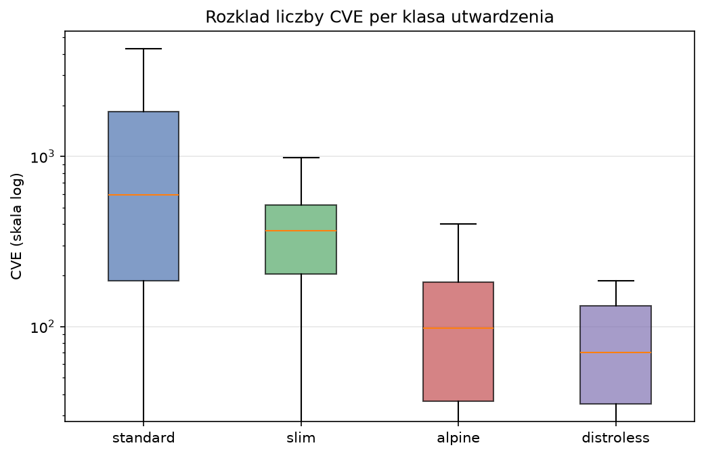

**Omówienie.** Porządek median jest monotoniczny: `standard` > `slim` > `alpine` > `distroless`.
Najważniejsza różnica to rozrzut: rozstęp międzykwartylowy `standard` obejmuje ponad rząd
wielkości (185–1 834), `slim` jest skupiony (203–517). Pudełka `alpine` i `distroless` niemal się
pokrywają — w opisie ekosystemu te dwie klasy są blisko siebie, różnią się dopiero na parach
(sekcja 6). To porównanie całych klas, nie par, więc miesza różne technologie i wersje.

**Zera trzeba opisać osobno.** 386 obrazów ma 0 CVE, ale część z nich to brak danych, nie brak
podatności:

- 121 obrazów ma 0 pakietów: `archlinux` (50), `busybox` (27), `fedora` (21), `alt`, `cirros`,
  `crux`, `mageia`, `clearlinux`. Trivy nie rozpoznał systemu albo nie ma dla niego bazy
  podatności, więc nie ma czego dopasować.
- 154 obrazy `debian` mają pakiety i 0 CVE. Są to m.in. tagi z okresu, gdy dana wersja była
  jeszcze `testing` (np. `debian:buster-20181011`, `bullseye-2019…`), oraz 30 obrazów linii
  `debian14` (`forky`). Prawdopodobna przyczyna: Trivy nie ma porad bezpieczeństwa dla
  wydań testowych. Do potwierdzenia w dokumentacji Trivy przed rozdziałem 5.

W tekście: „0 CVE” oznacza „brak dopasowania w bazie skanera”, a nie obraz bez podatności.

### 5.2 Powierzchnia ataku: rozmiar i pakiety

| Klasa | Mediana rozmiaru [MB] | Q1–Q3 [MB] | Mediana pakietów | Q1–Q3 pakietów | Mediana CVE / pakiet |
| --- | --- | --- | --- | --- | --- |
| `standard` | 200,3 | 92,7–334,9 | 193 | 119–409 | 3,36 |
| `slim` | 66,6 | 29,9–86,3 | 168 | 96–274 | 1,84 |
| `alpine` | 65,6 | 38,8–118,5 | 74 | 32–209 | 1,11 |
| `distroless` | 21,5 | 9,0–50,4 | 13 | 9–24 | 4,96 |

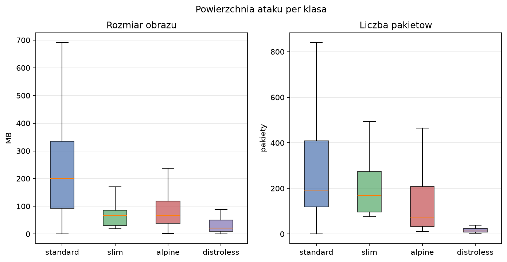

**Omówienie.** `slim` i `alpine` mają tę samą medianę rozmiaru (~66 MB), ale `alpine` ma ponad
dwa razy mniej pakietów (74 wobec 168). Rozmiar i liczba pakietów nie są więc wymienne jako
miara powierzchni. Distroless ma medianę 13 pakietów, a jednocześnie najwyższą gęstość CVE na
pakiet (4,96) — zostają w nim właśnie te biblioteki, które w Debianie mają najwięcej
zgłoszeń (glibc, libssl, runtime języka).

Rozmiar distroless pierwotnie był pusty (`GetRepo.py gcr` nie zapisywał `arch_size`).
Uzupełniono go 26.10.2026 przez `src/GcrMeta.py` jako sumę pól `size` warstw z manifestu `amd64`
w `gcr.io`, bez ponownego skanowania. To ta sama miara co `arch_size` z API Huba — na 6 losowych
obrazach Huba suma warstw z manifestu była identyczna z `arch_size` co do bajta.

Liczba pakietów z `--list-all-pkgs` obejmuje też pakiety języków (np. moduły npm dołączone do
Node.js), nie tylko pakiety systemowe. Widać to w `distroless/nodejs-debian9` (377 pakietów).

### 5.3 Krytyczność

| Klasa | CRITICAL | HIGH | MEDIUM | LOW | UNKNOWN | Udział CVE z poprawką |
| --- | --- | --- | --- | --- | --- | --- |
| `standard` | 2,0% | 19,6% | 58,5% | 19,1% | 0,9% | 54,8% |
| `slim` | 1,9% | 21,1% | 55,0% | 20,8% | 1,3% | 47,1% |
| `alpine` | 3,7% | 39,1% | 41,3% | 14,0% | 2,0% | **99,0%** |
| `distroless` | 3,2% | 20,5% | 46,8% | 26,4% | 3,2% | 48,2% |

Mediana CRITICAL na obraz: 9 (`standard`), 9 (`slim`), 3 (`alpine`), 0 (`distroless`).

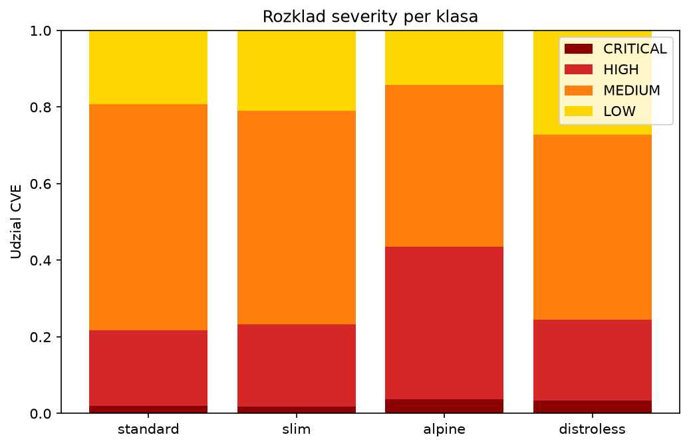

**Omówienie.** `alpine` ma najmniej CVE, ale największy *udział* HIGH i CRITICAL (43% wobec
~22% w Debianie). Bezwzględnie to nadal znacznie mniej poważnych podatności (mediana CRITICAL
3 wobec 9). Udział CVE z dostępną poprawką w `alpine` wynosi 99%, w klasach debianowych około
50%.

To drugie jest najpewniej skutkiem źródła danych, a nie samej metody utwardzania: baza
bezpieczeństwa Alpine (secdb) wymienia głównie podatności już naprawione, a Debian Security
Tracker zawiera także te bez poprawki („no DSA”, „will not fix”). Część różnicy `alpine` vs
`standard` może więc wynikać z asymetrii źródeł porad. To trzeba sprawdzić i zapisać w
ograniczeniach; jest to zgodne z uwagą Rice o różnicach między źródłami porad dystrybucji.
Etykiety krytyczności pochodzą z pola `Severity` w raporcie Trivy (patrz `LITERATURA.md`, CVSS).

### 5.4–5.5 Zależność CVE od rozmiaru i liczby pakietów

| Zakres | Spearman ρ (CVE ~ rozmiar) | Spearman ρ (CVE ~ pakiety) |
| --- | --- | --- |
| wszystkie obrazy | **0,570** (n = 9 755) | **0,599** (n = 9 755) |
| `standard` | 0,544 | 0,631 |
| `slim` | 0,560 | 0,276 |
| `alpine` | 0,166 | 0,456 |
| `distroless` | 0,586 (n = 55) | 0,578 (n = 55) |

Wszystkie p < 10⁻¹¹ poza wierszem `distroless` (n = 55, p < 10⁻⁵).

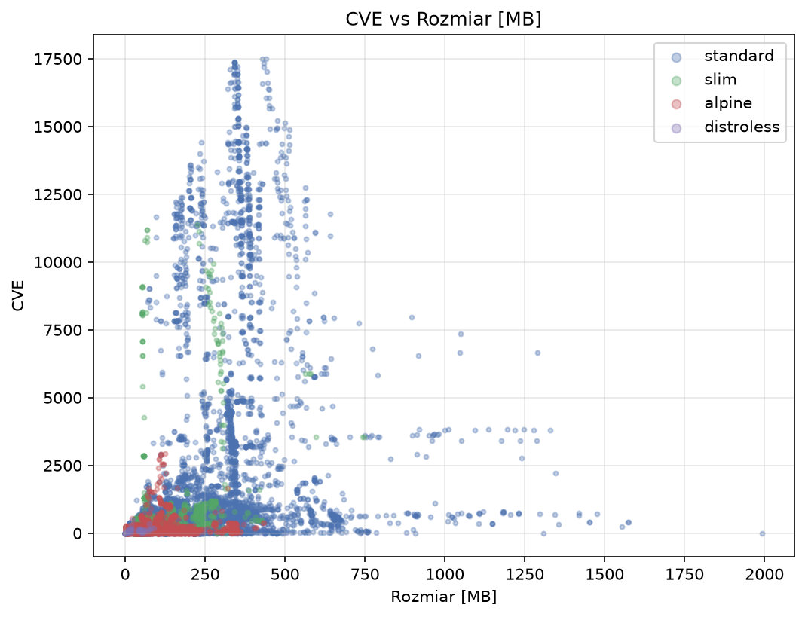

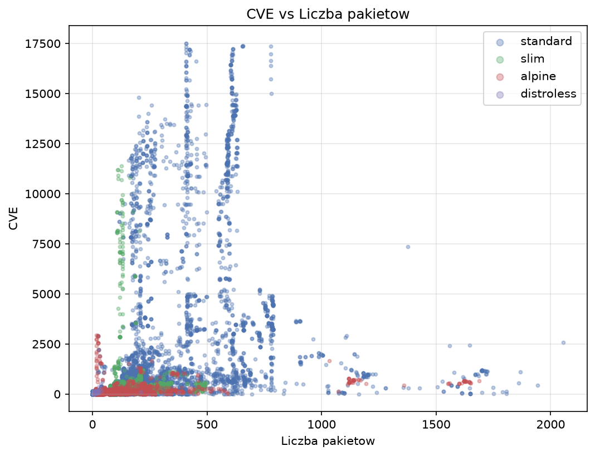

**Omówienie.** Korelacja jest umiarkowana (ρ ≈ 0,6), nie silna. Mniejszy obraz zwykle ma mniej
CVE, ale rozmiar tłumaczy tylko część różnic. Wewnątrz `alpine` rozmiar prawie nie ma związku z
CVE (ρ = 0,17) — duże obrazy alpine są duże przez runtime języka, nie przez pakiety systemowe.
W `slim` liczy się rozmiar, a liczba pakietów słabo (ρ = 0,28). Wniosek do rozdziału 5:
„mniejszy obraz = bezpieczniejszy” jest uproszczeniem; ważniejsze jest, *które* pakiety zostają.

### 5.6 Świeżość bazy: linia Debiana

Mediana CVE według linii i klasy:

| Linia | `standard` (n) | `slim` (n) | `distroless` (n) | Wszystkie |
| --- | --- | --- | --- | --- |
| `debian7` | 1 056 (56) | 158 (2) | — | 1 056 |
| `debian8` | 872 (56) | 138 (27) | — | 259 |
| `debian9` | 1 607 (244) | 155 (119) | 54 (7) | 546 |
| `debian10` | 1 046 (411) | 223 (291) | 109 (8) | 497 |
| `debian11` | **7 398** (637) | 516 (374) | 144 (15) | 863 |
| `debian12` | 994 (568) | 368 (315) | 70 (12) | 723 |
| `debian13` | 1 021 (329) | 396 (171) | 33 (13) | 741 |
| `debian14` | 0 (20) | 0 (15) | — | 0 |

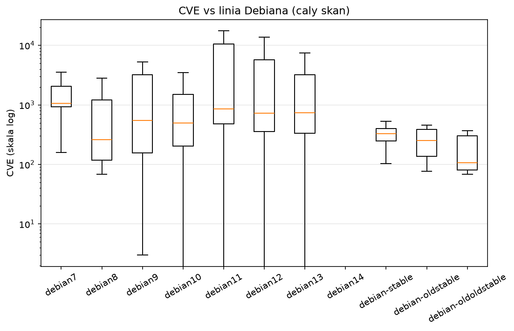

**Omówienie.** Nowsza linia nie oznacza automatycznie mniej CVE w klasie `standard`: `debian11`
ma medianę 7 398, wyraźnie więcej niż starsze `debian9`–`10`. Pełne obrazy na `bullseye`
(`node`, `gcc`, `rust` na `buildpack-deps`) mają kilkanaście tysięcy CVE i to one tworzą górną
gałąź na wykresie 5.7. W distroless widać za to wyraźny spadek od `debian11` do `debian13`
(144 → 70 → 33), zgodny z tym, że Google aktualizuje tylko bieżącą linię. `debian14` ma 0 CVE,
ale to brak porad dla wydania testowego (sekcja 5.1), a nie wynik.

Etykiety `debian-stable` / `oldstable` / `oldoldstable` to tagi `debian` wskazujące linię
nazwą roli, a nie numerem.

### 5.7 Wiek tagu

Spearman ρ (wiek w dniach ~ CVE), wiek liczony od najnowszego tagu w próbie (06.10.2026).
Przeliczone 26.10.2026 po uzupełnieniu dat distroless:

| Klasa | n | ρ |
| --- | --- | --- |
| wszystkie | 9 755 | 0,105 |
| `standard` | 6 223 | 0,133 |
| `slim` | 1 683 | **−0,145** |
| `alpine` | 1 794 | 0,287 |
| `distroless` | 55 | 0,208 (p = 0,13) |

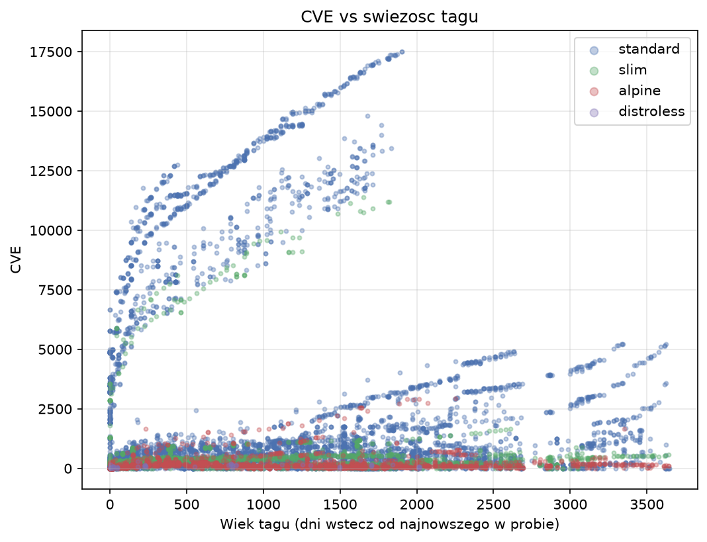

**Omówienie.** Związek wieku z liczbą CVE jest słaby (ρ = 0,10). Wykres pokazuje, dlaczego:
obrazy układają się w wyraźne gałęzie, z których każda to jedna technologia na jednej bazie.
W obrębie gałęzi CVE rośnie z wiekiem (starszy build = więcej znanych dziś podatności), ale
gałęzie leżą na różnych poziomach. Najwyższa gałąź (do 17 500 CVE) to pełne obrazy na
`bullseye`. W `slim` korelacja jest nawet ujemna, bo nowe obrazy `slim` mają nowsze runtime'y z
większą liczbą zależności. Wiek tagu bez kontroli technologii i bazy nie jest dobrym
predyktorem. W distroless związek jest nieistotny (p = 0,13): liczbę CVE wyznacza tu głównie
linia Debiana i technologia, a nie data obrazu.

---

## 6. Punkt APD 6 — porównanie metod utwardzania

Para = obraz utwardzony i `standard` z tej samej grupy (`group_id`), obie strony przeskanowane.
Delta = utwardzony − `standard`; delta procentowa = delta / CVE `standard`. Test Wilcoxona
jednostronny (H₁: delta < 0), przedziały ufności 95% bootstrapem mediany (2 000 prób, ziarno
2026).

### 6.1 Liczba par po skanie

| Metoda | Pary w matrycy | Pary po skanie | Repozytoria |
| --- | --- | --- | --- |
| `slim` | 1 529 | **1 507** | 21 |
| `alpine` | 1 336 | **1 315** | 53 |
| `distroless` | 40 | **40** | 4 |

### 6.2 Wynik główny — mediany per repozytorium

| Metoda | n repo | Mediana ΔCVE | CI 95% | Mediana ΔCVE % | CI 95% | p (Wilcoxon) |
| --- | --- | --- | --- | --- | --- | --- |
| `slim` | 21 | −331 | [−3 326; −184] | **−53,1%** | [−84,7; −35,4] | 3,8·10⁻⁶ |
| `alpine` | 53 | −507 | [−978; −280] | **−90,9%** | [−96,3; −86,3] | 3,1·10⁻¹⁰ |
| `distroless` | 4 | −2 211 | [−8 712; −154] | **−90,6%** | [−98,9; −84,9] | 0,0625 |

### 6.3 Wynik pomocniczy — wszystkie pary

| Metoda | n par | Mediana ΔCVE | CI 95% | Mediana ΔCVE % | CI 95% | p | Pary gorsze | Pary bez zmiany |
| --- | --- | --- | --- | --- | --- | --- | --- | --- |
| `slim` | 1 507 | −939 | [−1 373; −619] | −62,7% | [−76,7; −46,7] | 6,7·10⁻¹⁷⁵ | 8 | 439 |
| `alpine` | 1 315 | −802 | [−836; −749] | −92,2% | [−93,2; −91,1] | 2,8·10⁻²¹¹ | 62 | 1 |
| `distroless` | 40 | −1 347 | [−3 187; −211] | −95,8% | [−98,4; −88,8] | 1,8·10⁻⁸ | 0 | 0 |

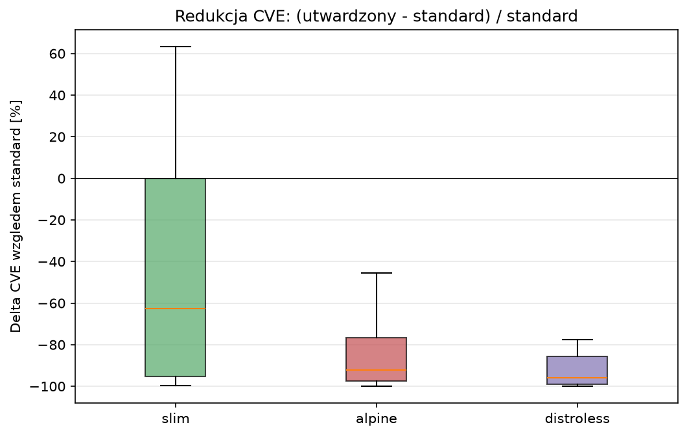

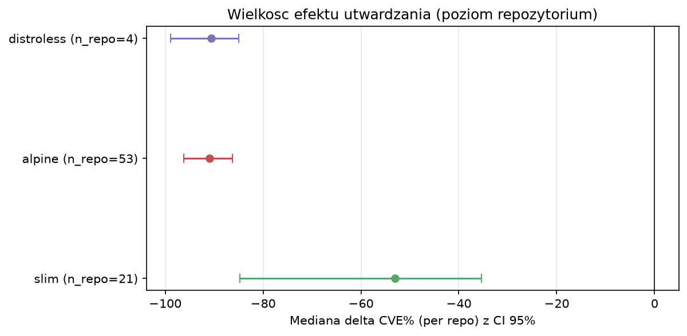

**Omówienie.** Wszystkie trzy metody istotnie zmniejszają liczbę CVE. `alpine` daje redukcję
około 91% z wąskim przedziałem ufności — efekt jest duży i powtarzalny w 53 repozytoriach.
`slim` daje około 53% przy szerokim przedziale (35–85%): efekt zależy mocno od technologii.
Distroless daje redukcję porównywalną z `alpine` (~91% per repozytorium, ~96% per para), ale
przy 4 repozytoriach test per repozytorium nie osiąga istotności (p = 0,0625 to minimum
osiągalne dla n = 4 w teście jednostronnym). Distroless raportujemy więc jako studium
przypadku: test na 40 parach jest istotny, test na repozytoriach z definicji nie może być.

Pudełko `slim` na wykresie 6.1 kończy się na 0: 439 z 1 507 par (29%) ma deltę dokładnie zero.
Wyjaśnienie w 6.4.

### 6.4 Heterogeniczność `slim` — ranking repozytoriów

| Repozytorium | Pary | Mediana ΔCVE % | Mediana Δpakietów % | Mediana Δrozmiaru % |
| --- | --- | --- | --- | --- |
| `node` | 561 | −96,1% | −53,1% | −80,4% |
| `erlang` | 11 | −95,9% | −84,1% | −80,8% |
| `swift` | 15 | −95,7% | −50,8% | −90,4% |
| `unit` | 1 | −95,1% | −73,0% | −83,2% |
| `python` | 38 | −94,6% | −76,6% | −87,3% |
| `pypy` | 45 | −94,4% | −76,9% | −81,9% |
| `ruby` | 28 | −84,7% | −64,6% | −81,6% |
| `elixir` | 3 | −78,6% | −78,3% | −75,5% |
| `oraclelinux` | 2 | −63,6% | −42,0% | −51,4% |
| `openjdk` | 17 | −53,7% | −51,7% | −40,9% |
| `tomcat` | 23 | −53,1% | −36,2% | −32,9% |
| `maven` | 8 | −42,5% | −26,0% | −40,4% |
| `perl` | 37 | −38,2% | −73,6% | −83,5% |
| `jetty` | 11 | −36,1% | −18,8% | −27,9% |
| `rust` | 64 | −35,4% | −68,9% | −46,0% |
| `haskell` | 13 | −26,0% | −57,7% | −42,2% |
| `mono` | 1 | −24,3% | −61,1% | −62,8% |
| `solr` | 25 | −19,0% | −4,7% | −13,4% |
| `clojure` | 151 | **0,0%** | 0,0% | −14,6% |
| `debian` | 452 | **0,0%** | 0,0% | −42,9% |
| `znc` | 1 | 0,0% | −24,3% | −71,5% |

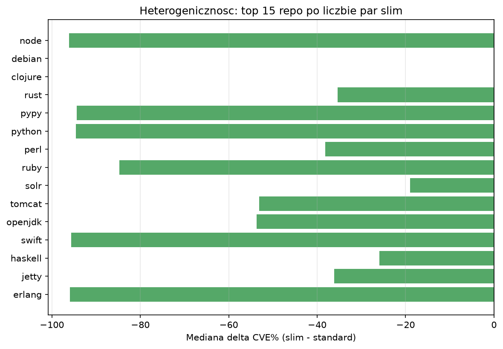

**Omówienie.** `slim` to w praktyce dwie różne operacje pod jedną nazwą:

1. **`slim` języków** (`node`, `python`, `ruby`, `erlang`…): standardowy obraz stoi na
   `buildpack-deps` z kompilatorami i bibliotekami deweloperskimi, a `slim` na gołym
   `debian:*-slim`. Usuwane są całe pakiety, więc CVE spada o 85–96%.
2. **`debian:*-slim`**: ten sam zestaw pakietów (Δ pakietów = 0), usunięte są tylko pliki —
   dokumentacja, strony `man`, lokalizacje. Rozmiar spada o 43%, a liczba CVE wcale, bo skaner
   liczy podatności po pakietach, nie po plikach. To samo w `clojure`.

To najciekawszy pojedynczy wynik dla rozdziału 6: **zmniejszenie rozmiaru bez usunięcia
pakietów nie zmienia profilu CVE**. Mediana per repozytorium (−53%) jest średnią z tych dwóch
mechanizmów, stąd szeroki przedział ufności.

Pary, w których `slim` ma *więcej* CVE (8): `jetty` (5) i `maven` (3) z JDK 16–18, np.
`jetty:11.0.7-jdk17` 367 → `-slim` 598. Wariant `slim` stoi tam na innej bazie niż pełny obraz.

### 6.5 Heterogeniczność `alpine`

Najmocniejsza redukcja: `spiped`, `varnish`, `erlang`, `httpd`, `ruby`, `python`, `elixir`,
`rust`, `php`, `golang` — wszystkie powyżej −99%. Najsłabsza i dodatnia:

| Repozytorium | Pary | Mediana ΔCVE % | Mediana Δpakietów % |
| --- | --- | --- | --- |
| `ghost` | 47 | −33,0% | −5,2% |
| `traefik` | 2 | +1,7% | +3,1% |
| `docker` | 3 | +2,7% | +311,8% |
| `caddy` | 10 | +3,2% | +1,5% |
| `nats` | 7 | **+26,4%** | +163,6% |
| `nats-streaming` | 8 | **+26,4%** | +1 500% |

62 z 1 315 par (4,7%) ma więcej CVE w `alpine`. Główne źródła: `jetty` (15), `gradle` (10),
`nats-streaming` (8), `amazoncorretto` (7), `nats` i `caddy` (po 6).

**Omówienie.** Gdy `alpine` wypada gorzej, prawie zawsze `standard` nie jest „pełnym” obrazem:

- `nats`, `nats-streaming`, `traefik`, `caddy`: obraz domyślny to pojedynczy plik binarny na
  `scratch` albo już na Alpine. Wariant `alpine` dokłada system, więc liczba pakietów rośnie.
- `gradle:*-ubi10`: `standard` stoi na Red Hat UBI 10 (20–24 CVE), `alpine` ma 250–370. Para
  porównuje dwie różne dystrybucje, nie dwa poziomy utwardzenia jednej.

Wniosek: `alpine` jest skuteczny wobec obrazów debianowych i ubuntowych. Wobec obrazów już
minimalnych albo na UBI może pogorszyć wynik.

### 6.6 Friedman: `standard` vs `slim` vs `alpine` w tych samych grupach

| Miara | Wartość |
| --- | --- |
| grupy z kompletem trzech klas | 300 (z 8 repozytoriów) |
| χ² Friedmana | 592,6 |
| p | 2,1·10⁻¹²⁹ |
| mediana CVE `standard` / `slim` / `alpine` | 3 526,5 / 371 / 98 |
| grupy ze ścisłym porządkiem `standard` > `slim` > `alpine` | **288 z 300** (96%) |
| grupy, w których `alpine` < `slim` | 299 z 300 |

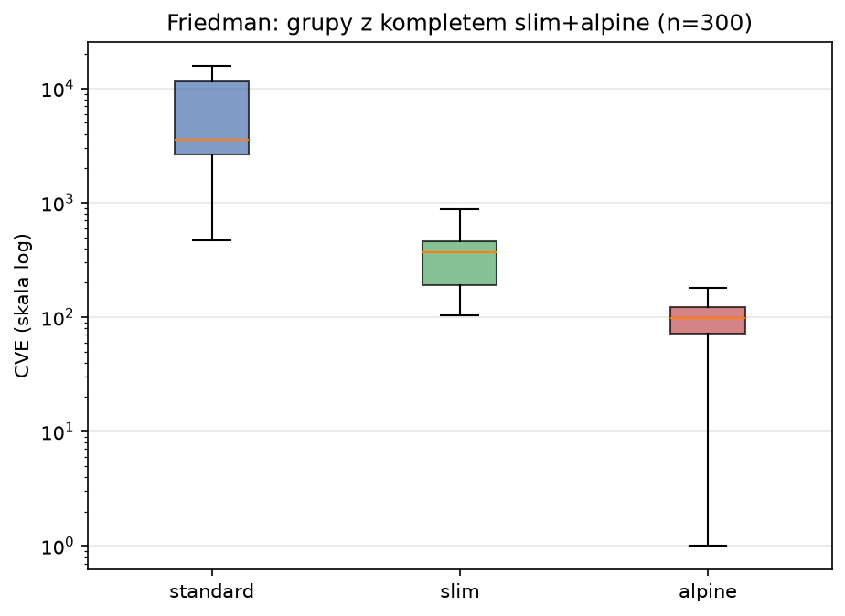

**Omówienie.** Gdy w jednej grupie są wszystkie trzy warianty, porządek jest niemal zawsze ten
sam, a `alpine` prawie zawsze wygrywa z `slim`. Zastrzeżenie: 300 grup pochodzi tylko z 8
repozytoriów, głównie języków z `buildpack-deps` (stąd mediana `standard` 3 526). To potwierdza
porządek, ale nie jest reprezentatywne dla całego ekosystemu.

### 6.7 Studium distroless

40 par z 4 repozytoriów partnera. Partnerzy: `debian` (18 par — `static`, `base`,
`base-nossl`, `cc`), `node` (13), `python` (7), `openjdk` (2). Java 17+ na `debian12`/`13` nie ma
partnera (brak stabilnych tagów `openjdk`), więc 14 z 15 obrazów Javy jest tylko w opisie.

| Partner | Pary | Mediana ΔCVE | Mediana ΔCVE % | Mediana Δpakietów % | Mediana Δrozmiaru % |
| --- | --- | --- | --- | --- | --- |
| `node` | 13 | −8 712 | −98,9% | −98,3% | −87,2% |
| `python` | 7 | −3 139 | −95,8% | −94,2% | −94,1% |
| `debian` | 18 | −154 | −85,3% | −92,5% | −82,9% |
| `openjdk` | 2 | −1 283 | −84,9% | −85,6% | −50,3% |

Wybrane pary:

| Distroless | Partner | CVE distroless | CVE partner | Pakiety |
| --- | --- | --- | --- | --- |
| `static-debian13` | `debian:13.7` | **0** | 164 | 6 vs 78 |
| `base-debian13` | `debian:13.7` | 23 | 164 | 10 vs 78 |
| `base-debian10` | `debian:10.13` | 58 | 68 | 6 vs 91 |
| `cc-debian10` | `debian:10.13` | 64 | 68 | 9 vs 91 |
| `nodejs22-debian13` | `node:22.23.3-trixie` | 31 | 3 218 | 14 vs 629 |
| `nodejs14-debian11` | `node:14.21.3-bullseye` | 164 | 14 995 | 10 vs 780 |
| `python3-debian13` | `python:3.13.16-trixie` | 168 | 3 248 | 38 vs 488 |
| `python3-debian12` | `python:3.11.17-bookworm` | 291 | 4 915 | 34 vs 447 |
| `python3-debian11` | `python:3.9.23-bullseye` | 480 | 11 492 | 36 vs 429 |
| `java17-debian11` | `openjdk:17.0.2-jdk-bullseye` | 182 | 2 065 | 23 vs 183 |

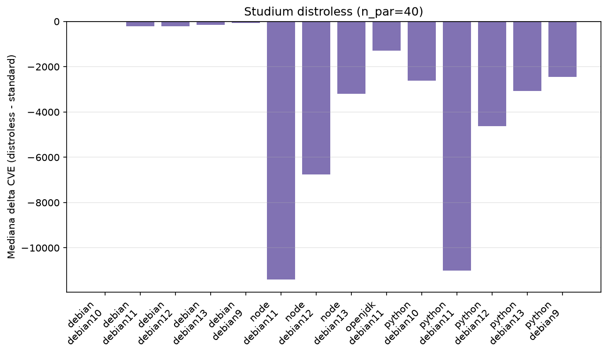

**Omówienie.**

- Żadna z 40 par nie wypada gorzej. Najmniejszy zysk mają `base` i `cc` na `debian10`
  (−15% i −6%): przy już małym `debian:10` zostają głównie glibc i libssl, które niosą większość
  CVE.
- Największy zysk bezwzględny jest przy runtime'ach (`node`, `python`), bo partner to pełny obraz
  na `buildpack-deps`. Część tej różnicy to zasługa samego przejścia na „mniej”, które daje też
  `slim`; porównanie z `slim` tej samej grupy dałoby uczciwszą miarę „dodatkowego” zysku
  distroless.
- Wynik zależy od linii Debiana: `python3-debian11` 480 CVE, `-debian12` 291, `-debian13` 168.
  Starsze linie nie są już aktualizowane przez Google.
- Wartości `python3-debian12` / `-debian13` różnią się od pilotażu (258 / 151), bo pilotaż był na
  Trivy `v0.74.0` i innej dacie bazy. W pracy podawać liczby kampanii.
- 5 z 55 obrazów distroless ma powłokę: `python2.7` i `python3` na `debian9`–`11`. Stare obrazy
  Pythona zawierały `/bin/sh`. Od `debian12` powłoki nie ma.

---

## 7. Punkt APD 7 — bezpieczeństwo a funkcjonalność

### 7.1 Co tracimy w parach

| Metoda | Mediana Δpakietów % (pary) | Mediana Δrozmiaru % (pary) | Utrata powłoki | Utrata `apt` |
| --- | --- | --- | --- | --- |
| `slim` | −41,9% | −57,4% | 0 z 1 507 | 0 z 1 507 |
| `alpine` | −64,8% | −51,5% | 0 z 1 315 | 1 209 z 1 315 (zamiana na `apk`) |
| `distroless` | −94,5% | −87,4% | 35 z 40 | 40 z 40 |

Per repozytorium (mediany): `slim` −53% CVE / −53% pakietów / −63% rozmiaru; `alpine` −91% / −61%
/ −44%; `distroless` −91% / −93% / −85%.

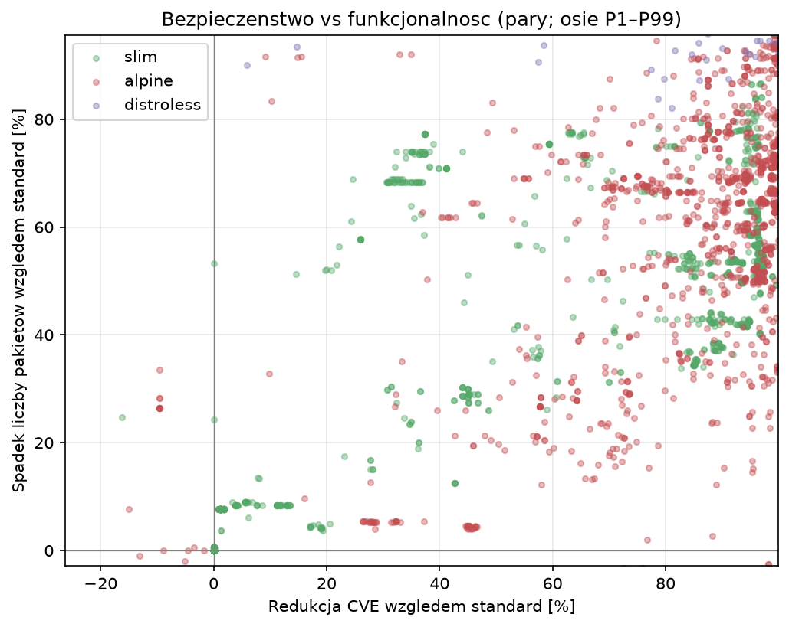

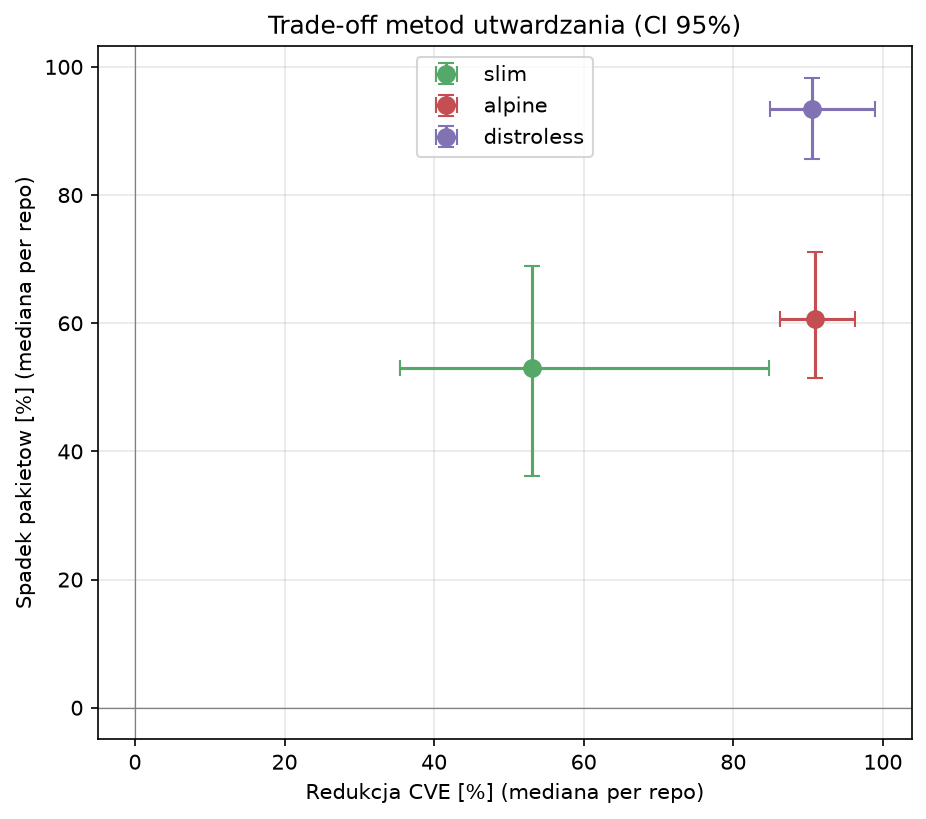

### 7.2 Cechy runtime per klasa

| Klasa | Powłoka | `apt` | `apk` | BusyBox |
| --- | --- | --- | --- | --- |
| `standard` | 96,6% | 81,8% | 4,2% | 4,3% |
| `slim` | 100% | 99,2% | 0,1% | 0,1% |
| `alpine` | 100% | 0% | 100% | 100% |
| `distroless` | 9,1% | 0% | 0% | 0% |

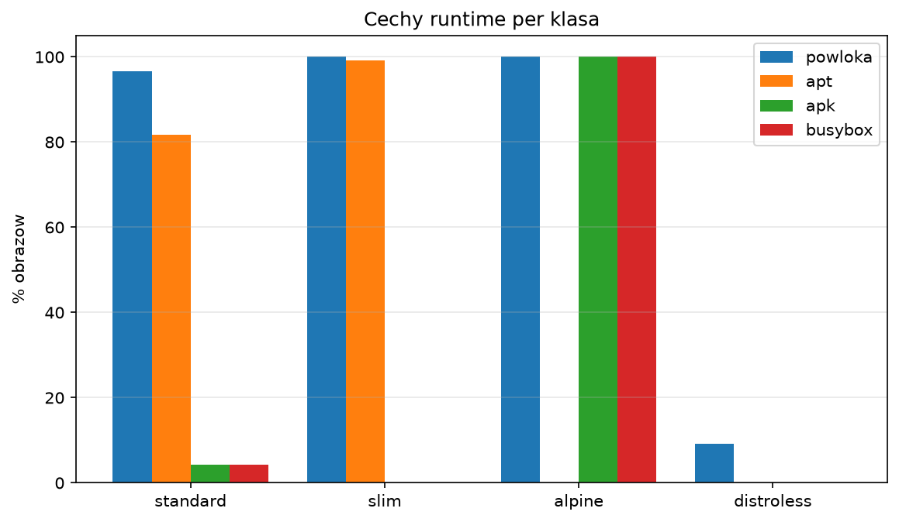

**Omówienie.** Trzy metody leżą w trzech różnych punktach kompromisu:

- **`slim`** — najmniejszy koszt funkcjonalny: zachowuje powłokę, `apt`, glibc i tę samą
  dystrybucję. Zysk CVE jest umiarkowany i silnie zależny od tego, czy usuwa pakiety (języki),
  czy tylko pliki (`debian`).
- **`alpine`** — zysk CVE porównywalny z distroless przy zachowaniu powłoki (BusyBox) i
  menedżera pakietów. Koszt: inna biblioteka C (musl zamiast glibc) i inny menedżer (`apk`), co
  może łamać binaria i zależności natywne. Część zysku może wynikać z asymetrii baz porad
  (sekcja 5.3).
- **`distroless`** — największe ograniczenie zawartości (−93% pakietów), zysk CVE podobny do
  `alpine`. Koszt: brak powłoki i menedżera pakietów, `ENTRYPOINT` w postaci wektorowej, debug
  tylko przez wariant `debug`. Dostępny dla nielicznych technologii.

Na wykresie 7.2 `alpine` i `distroless` mają niemal tę samą redukcję CVE, a różnią się o ~30
punktów procentowych utraty pakietów. Przy tej samej redukcji CVE `alpine` zachowuje więcej
funkcji. Distroless ma za to bonus nieliczony w CVE: wariant `nonroot` bez zmiany zawartości
(51 z 56 repozytoriów).

---

## 8. Najbardziej skrajne obrazy

Najwięcej CVE (wszystkie `standard` na `debian11`):

| Obraz | CVE | CRITICAL | Pakiety | Rozmiar [MB] |
| --- | --- | --- | --- | --- |
| `gcc:11.1.0-bullseye` | 17 508 | 327 | 409 | 428 |
| `rust:1.53.0-bullseye` | 17 508 | 327 | 409 | 441 |
| `node:16.7.0-bullseye` | 17 384 | 326 | 656 | 342 |
| `node:16.8.0-bullseye` | 17 371 | 323 | 654 | 342 |
| `node:14.17.6-bullseye` | 17 360 | 325 | 777 | 343 |

`gcc` i `rust` mają identyczny profil, bo dzielą tę samą bazę `buildpack-deps:bullseye`. To
pokazuje, że w pełnych obrazach liczbę CVE wyznacza baza, a nie aplikacja.

Najmniej CVE przy niezerowej liczbie pakietów w distroless: `static-debian13` (0 CVE,
6 pakietów), `static-debian12` (1), `static-debian9` (3), `static-debian11` (5).

---

## 9. Zastrzeżenia do wyników (do rozdziału o ograniczeniach)

1. **Punkt w czasie.** Jedna baza CVE z 10.10.2026. Wyniki porównują klasy przy tej samej
   wiedzy o podatnościach; bezwzględne liczby będą rosły.
2. **0 CVE ≠ bezpieczny.** 121 obrazów bez rozpoznanych pakietów i ~180 obrazów z wydań
   testowych Debiana dają zero przez brak danych.
3. **Asymetria źródeł porad.** Alpine secdb vs Debian Security Tracker — 99% vs ~50% CVE z
   poprawką. Część przewagi `alpine` może być artefaktem danych.
4. **Pary między dystrybucjami.** `alpine` dołącza do grupy najnowszego `standard`, który może
   stać na UBI, `scratch` albo już na Alpine. Takie pary nie mierzą utwardzania jednej bazy.
5. **Rozmiar distroless uzupełniony po kampanii.** Potok nie zapisał `arch_size` dla `gcr.io`;
   wartości dopisano 26.10.2026 z manifestów (`src/GcrMeta.py`), bez wpływu na skany.
6. **Distroless n = 4 repozytoria.** Test per repozytorium nie może osiągnąć p < 0,05.
7. **Friedman z 8 repozytoriów.** Porządek potwierdzony, reprezentatywność ograniczona.
8. **Przesunięcie próby w stronę nowszych obrazów** przez sondę lustra (58% kandydatów odpadło)
   i 168 porażek skanu (1,7%, w tym 53 obrazy z 2016 r.).
9. **Liczba pakietów** obejmuje pakiety języków, nie tylko systemowe.
10. **Wiek distroless z innego pola niż na Hubie.** Config obrazów distroless ma
    `created = 1970-01-01` (odtwarzalny build Bazela), więc wiek wzięto z `timeUploadedMs`
    przeskanowanego digestu w `gcr.io/v2/<repo>/tags/list` (uzupełnione 26.10.2026). Na Hubie
    jest to data publikacji tagu — obie miary oznaczają moment opublikowania obrazu.

---

## 10. Wnioski w jednym akapicie

Na 9 755 obrazach z Docker Official Images i `gcr.io/distroless` wszystkie trzy metody
utwardzania istotnie zmniejszają liczbę znanych podatności względem obrazu standardowego tej
samej technologii i wersji. `alpine` daje około 91% redukcji w 53 repozytoriach, przy zachowaniu
powłoki, ale ze zmianą biblioteki C i menedżera pakietów. Distroless daje redukcję podobnego
rzędu (91% per repozytorium, 96% per para), przy największej utracie funkcji, i jest dostępny
tylko dla kilku technologii. `slim` daje około 53%, ale jest dwiema różnymi operacjami: w obrazach
języków usuwa pakiety i redukuje CVE o 85–96%, w `debian` usuwa tylko pliki i nie zmienia liczby
CVE. Liczba CVE koreluje umiarkowanie z rozmiarem i liczbą pakietów (ρ ≈ 0,6) i słabo z wiekiem
tagu (ρ ≈ 0,1); silniej zależy od bazy, na której obraz stoi.
